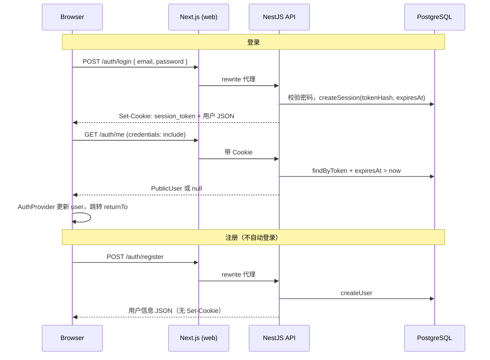
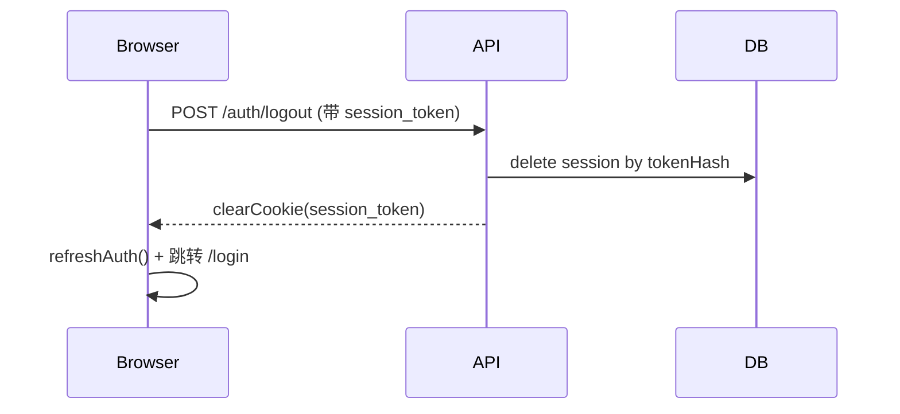
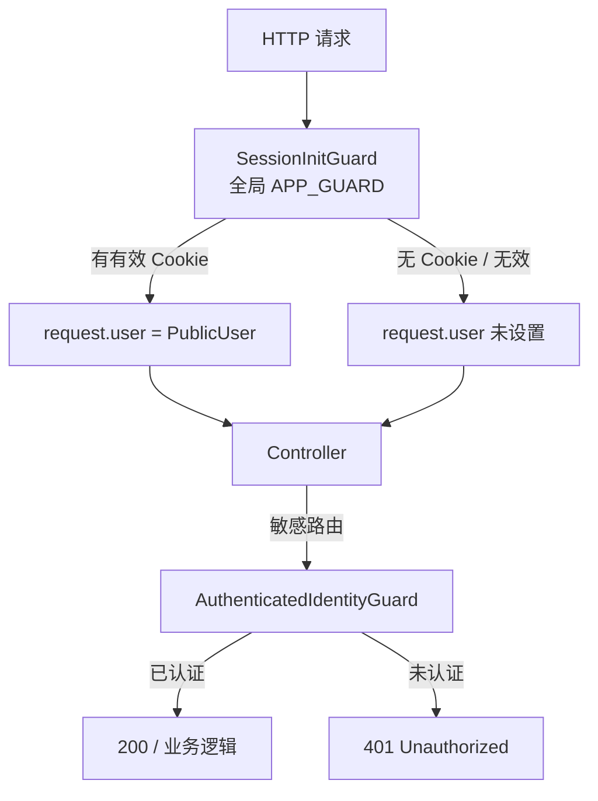

# 用户认证与会话架构

**日期：** 2026-09-08  
**状态：** 当前实现  

本文描述 xtai-notion-open 的登录、Session Cookie、过期策略与前后端鉴权流程。项目采用 **基于 Session Cookie 的认证**（非 JWT）：浏览器持有 `session_token`，服务端在 PostgreSQL 中存储 token 的 SHA256 哈希。

---

## 1. 架构定位

| 维度 | 说明 |
|------|------|
| 认证方式 | Session Cookie + 数据库 `user_session` 表 |
| Cookie 名 | `session_token` |
| Token 形态 | 64 字符 hex（`randomBytes(32)`） |
| 过期时间 | 登录起 **30 天**，固定不续期 |
| 前端状态 | `AuthProvider` 通过 `GET /auth/me` 维护全局用户 |
| 后端鉴权 | 全局 `SessionInitGuard` + 路由级 `AuthenticatedIdentityGuard` |
| 同源代理 | Next.js 将 `/auth/*` rewrite 到 API，Cookie 落在 web 域名 |

**关键源码：**

- `apps/api/src/auth/auth.controller.ts` — 登录/登出/当前用户
- `apps/api/src/auth/auth.service.ts` — 注册、登录、session 创建
- `apps/api/src/auth/session.repository.ts` — session 持久化与校验
- `apps/web/components/auth-provider.tsx` — 前端全局认证状态
- `apps/web/lib/api-client.ts` — 统一 fetch（`credentials: include`）
- `apps/web/next.config.ts` — `/auth/:path*` 反向代理

---

## 2. 登录与注册流程



### 2.1 登录（前端）

1. `apps/web/app/login/page.tsx` 提交邮箱/密码，`POST /auth/login`
2. `apiRequest` 默认 `credentials: "include"`，自动携带/接收 Cookie
3. 成功后调用 `refreshAuth()`（即 `GET /auth/me`）刷新 `AuthProvider`
4. 跳转到 `returnTo` 查询参数，或默认 `/documents`（仅允许站内相对路径）

### 2.2 登录（后端）

1. 邮箱 `trim` + 小写，查用户并 bcrypt 校验密码
2. 生成随机 token，计算 `expiresAt = now + 30 天`
3. `SessionRepository.createSession` 将 **SHA256(token)** 写入数据库
4. 响应体返回 `PublicUser`（id、email、displayName、color、role），**不含 token**

### 2.3 注册

- `POST /auth/register` 仅创建账号，**不**写入 Cookie、不创建 session
- 用户需再到登录页完成登录

---

## 3. Cookie 设置

登录成功时由 `AuthController.login` 写入：

| 属性 | 值 | 含义 |
|------|-----|------|
| 名称 | `session_token` | 会话标识 |
| `httpOnly` | `true` | JS 不可读，降低 XSS 窃取风险 |
| `sameSite` | `lax` | 同站请求携带 Cookie |
| `secure` | 生产环境 `true` | 仅 HTTPS 传输 |
| `path` | `/` | 全站有效 |
| `expires` | 与 DB `expires_at` 一致 | 浏览器侧过期时间 |

**同源代理原因：** 若前端直接请求 `127.0.0.1:PORT` 等 API 地址，Cookie 域名与 web 不一致会导致 session 丢失。Next.js rewrite 使 `/auth/*` 在浏览器看来属于 web 源，Cookie 正确绑定。

```ts
// apps/web/next.config.ts
{ source: "/auth/:path*", destination: `${apiUrl}/auth/:path*` }
```

---

## 4. 过期策略

| 问题 | 行为 |
|------|------|
| 何时过期 | 登录时刻起 **30 天**（`addDays(new Date(), 30)`） |
| 是否滑动续期 | **否**；`last_seen_at` 字段存在但请求路径中未更新 |
| DB 校验 | `findByToken` 要求 `expiresAt > new Date()` |
| Cookie 过期后 | `/auth/me` 返回 `null`；受保护 API 返回 401 |
| 前端表现 | `AuthProvider.user = null`；`/documents` 等 layout 重定向到 `/login?returnTo=...` |

**安全存储：** Cookie 存明文 token；数据库只存 SHA256 哈希，DB 泄露无法直接还原可用 token。

---

## 5. 登出



- 后端：`SessionRepository.revoke` 删除对应 session，`clearCookie` 清除浏览器 Cookie
- 前端：`AuthMenu` 调用 `/auth/logout` 后 `refresh()`，再 `window.location.assign("/login")`

---

## 6. 后端鉴权

### 6.1 Guard 分层



| Guard | 作用域 | 行为 |
|-------|--------|------|
| `SessionInitGuard` | 全局（`app.module.ts`） | 解析 Cookie，有效则挂载 `request.user`；**不强制登录** |
| `AuthenticatedIdentityGuard` | 文档、AI、上传、评论、后台等 | 必须有身份，否则 401 |

`AuthenticatedIdentityGuard` 接受的身份来源（按实际解析顺序）：

1. `SessionInitGuard` 已设置的 `request.user`
2. 非生产环境请求头 `x-dev-user-id`（本地开发）
3. 兜底：再次从 `Cookie: session_token=...` 解析并查库

控制器通过 `@CurrentUser()` 装饰器读取当前用户（`apps/api/src/auth/current-user.decorator.ts`）。

### 6.2 使用 AuthenticatedIdentityGuard 的模块

- `documents.controller.ts`
- `ai.controller.ts`
- `image-upload.controller.ts`
- `comments.controller.ts`
- `document-comments.controller.ts`
- `admin.controller.ts`

### 6.3 CORS

`apps/api/src/main.ts` 启用 `credentials: true`，允许浏览器跨源携带 HttpOnly Cookie（配合 web 同源代理时，多数请求仍走同域）。

---

## 7. 前端鉴权

### 7.1 AuthProvider

- 挂载于 `AppProviders`，全站可用
- 初始与 `refresh()` 时请求 `GET /auth/me`
- 将 API 的 `displayName` 规范为前端的 `name` 字段
- 使用 `requestId` 防止并发请求导致「登录后被旧响应登出」

### 7.2 路由级保护（客户端）

| 路由 | 规则 |
|------|------|
| `/documents/*` | `loading` 结束后无 `user` → `/login?returnTo=pathname` |
| `/admin/*` | 无 `user` → 登录页；`role !== "admin"` → toast + 重定向 `/documents` |
| `/square` 等 | 不强制登录；登录后显示用户菜单 |

### 7.3 API 请求约定

`apiRequest` / `apiRequestJson`（`apps/web/lib/api-client.ts`）：

- 默认 `credentials: "include"`
- `/auth/`、`/api/`、`/share/` 前缀走同源，不拼 `NEXT_PUBLIC_API_URL`
- 开发环境可选 `userId` 参数设置 `x-dev-user-id` 头

---

## 8. 协作编辑认证

WebSocket 连接由 `CollaborationAuthService`（`apps/api/src/collaboration/collaboration-auth.service.ts`）鉴权：

1. 优先从连接 token 或 `x-dev-user-id` 解析 `userId`
2. 否则从请求 Cookie 解析 `session_token`，经 `AuthService.findUserBySessionToken` 映射用户
3. 再调用 `DocumentsService.assertCanRead` 确定文档角色与只读状态

---

## 9. 开发环境特殊机制

| 机制 | 条件 | 用途 |
|------|------|------|
| `x-dev-user-id` 请求头 | `NODE_ENV !== "production"` | 免 Cookie 模拟指定用户 |
| `DevelopmentIdentityGuard` | 仅 dev/test | 强制要求 dev 头（部分测试/旧路径） |
| `NEXT_PUBLIC_DEV_USER_ID` | 前端 env | 可配合 api-client 传 dev 头 |

**生产环境：** dev 头无效，必须通过 Cookie session 认证。

---

## 10. 数据模型（Session）

Prisma 模型 `UserSession`（`apps/api/prisma/schema.prisma`）主要字段：

- `userId` — 所属用户
- `tokenHash` — SHA256(session token)
- `expiresAt` — 过期时间
- `lastSeenAt` — 创建时写入，当前未用于续期

---

## 11. 面试速答要点

1. **为什么不用 JWT？** 服务端 session 可随时 revoke（登出即删库）；token 哈希存库，Cookie 泄露窗口可控；`/auth/me` 轻量查库即可。
2. **为什么 auth 走 Next rewrite？** 保证 Cookie 与页面同域，避免本地/拆分部署时 hostname 不一致。
3. **过期后用户体验？** 前端 layout 重定向登录；API 401；无全局 refresh token 或自动续期。
4. **权限如何分层？** 登录态（session）与业务权限（文档 role、admin role）分离；admin 在前端 layout + 后端 controller 双重校验。
5. **注册为何不自登录？** 当前实现注册只建用户记录，session 仅在 `login` 路径创建并写 Cookie。

---

## 12. 相关文件索引

| 文件 | 职责 |
|------|------|
| `apps/api/src/auth/auth.controller.ts` | HTTP：register / login / logout / me |
| `apps/api/src/auth/auth.service.ts` | 业务：密码校验、session 生命周期 |
| `apps/api/src/auth/session.repository.ts` | DB：token 哈希、过期查询、revoke |
| `apps/api/src/auth/session-init.guard.ts` | 全局 session 解析 |
| `apps/api/src/auth/authenticated-identity.guard.ts` | 强制认证 |
| `apps/api/src/auth/current-user.decorator.ts` | 控制器取当前用户 |
| `apps/web/components/auth-provider.tsx` | 前端用户状态 |
| `apps/web/components/auth-menu.tsx` | 登录/登出 UI |
| `apps/web/app/documents/layout.tsx` | 文档区登录保护 |
| `apps/web/app/admin/layout.tsx` | 后台 admin 保护 |
| `apps/web/app/login/page.tsx` | 登录页 |
| `apps/web/app/register/page.tsx` | 注册页 |
