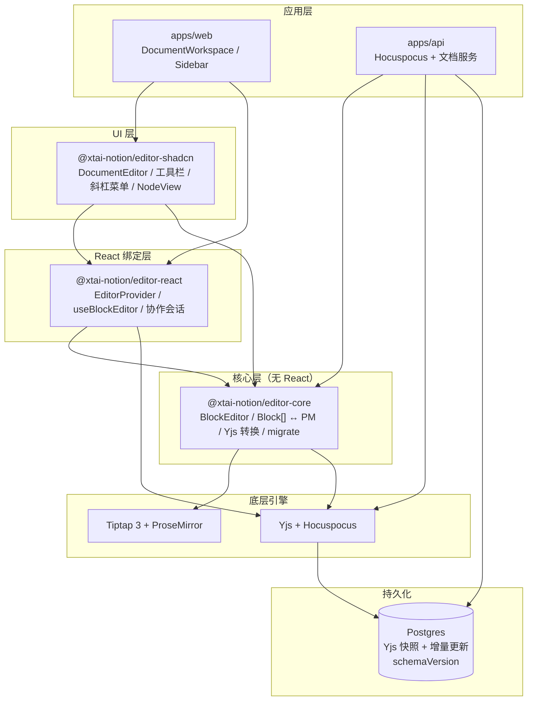
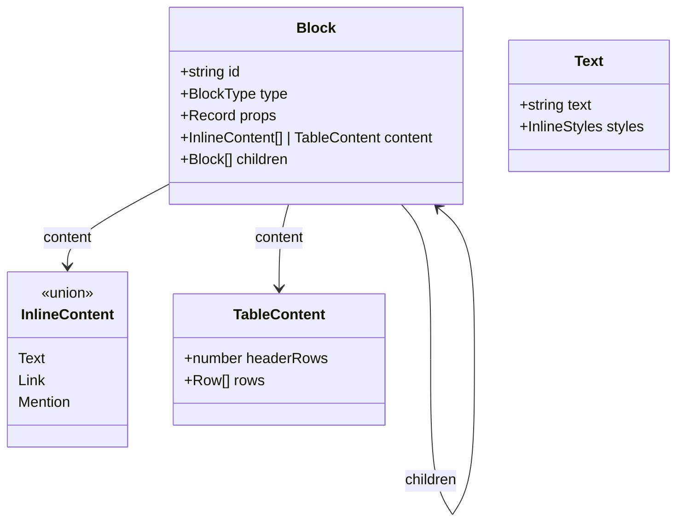
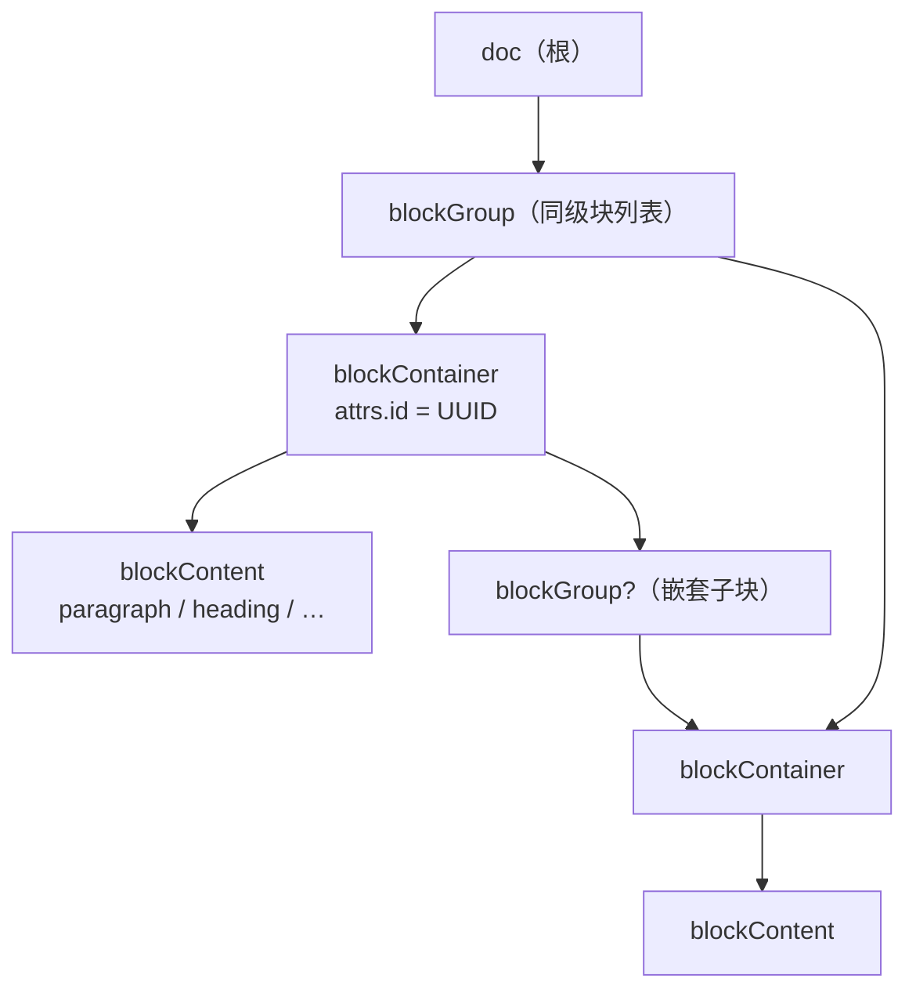
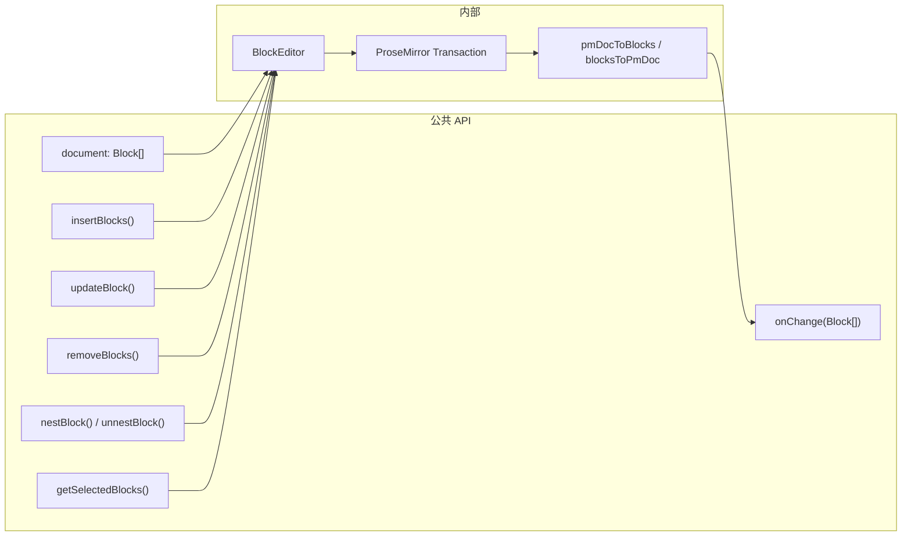
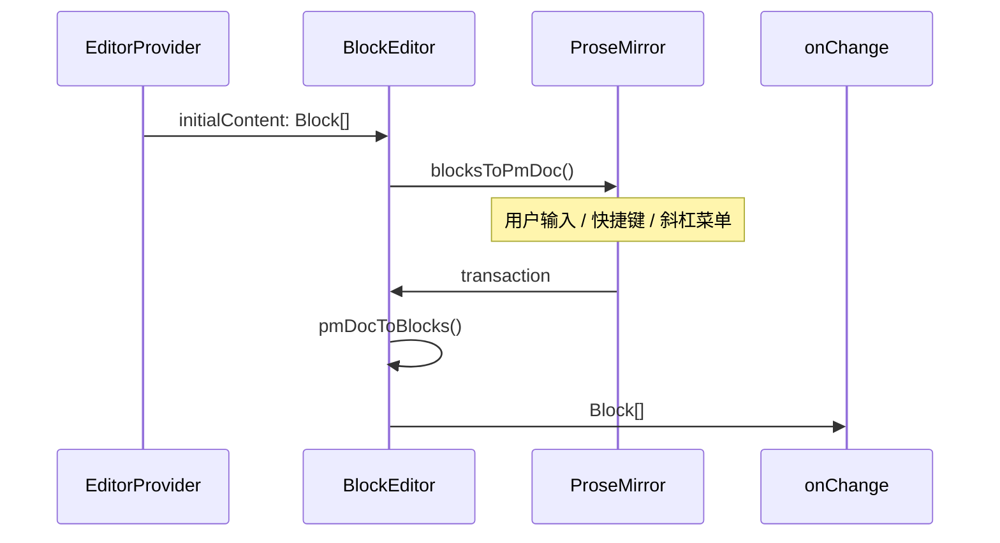
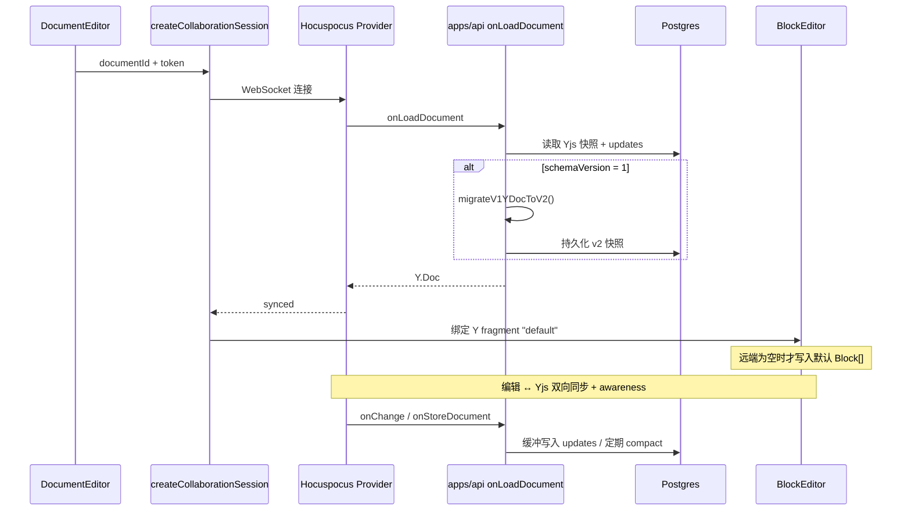
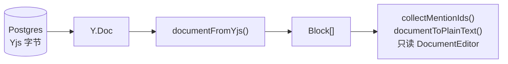
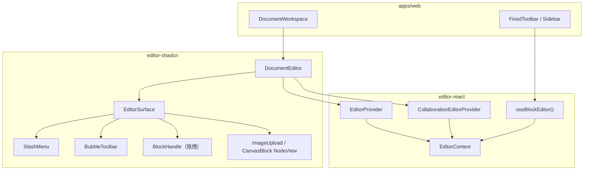
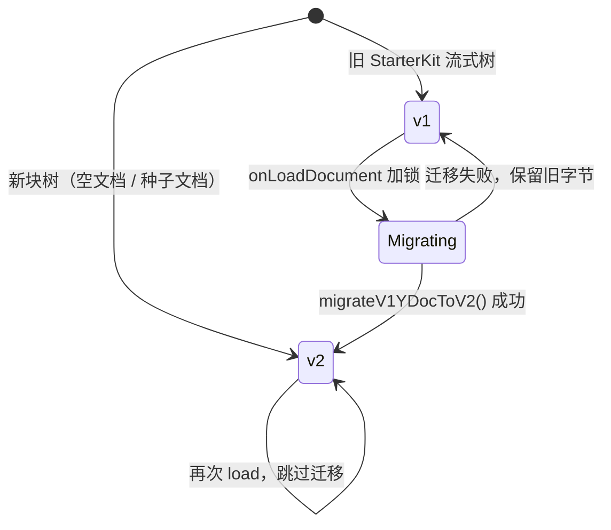

# 块编辑器架构

**日期：** 2026-08-28  
**状态：** 当前实现  
**参考：** [BlockNote](https://github.com/TypeCellOS/BlockNote)（分层与块模型，非源码依赖）

本文描述 xtai-notion-open 的块文档编辑器架构：对外以 `Block[]` 为文档单位，内部基于 Tiptap 3 + ProseMirror + Yjs 实现，协同经 Hocuspocus 持久化到 Postgres。

---

## 1. 与 BlockNote 的关系

| 维度 | 本项目 | BlockNote |
|------|--------|-----------|
| 对外文档类型 | `Block[]` | `Block[]` |
| 底层引擎 | Tiptap + ProseMirror + Yjs | Tiptap + ProseMirror + Yjs |
| NPM 依赖 | **无** `@blocknote/*` | `@blocknote/core` / `react` / `mantine` |
| 实现方式 | 自研 `editor-core` 等包 | 独立开源项目 |
| 内部 PM 树 | `blockGroup` → `blockContainer` → `blockContent` | 同形文档树 |

> 学 BlockNote 的分层与块模型，不复制其源码。详见 [块文档架构设计](./superpowers/specs/2026-08-28-block-document-architecture-design.md)。

---

## 2. 包分层与依赖

**包边界约束：**

- `editor-core` 源码不得出现 `react`、`@tiptap/react`、`@workspace/ui`
- `apps/web` 通过 `editor-shadcn` / `editor-react` 使用编辑器，不直接依赖 Tiptap 公共 API
- `apps/api` 仅依赖 `editor-core`（含 `/migrate` 子路径做 v1→v2 迁移）

---

## 3. 块数据模型

对外公共类型定义于 `packages/editor-core/src/core/block-schema/types.ts`。

**第一期块类型：**

| 块 | `type` | 说明 |
|---|---|---|
| 段落 | `paragraph` | 默认块，文档末尾保留一块空段落 |
| 标题 | `heading` | `props.level`: 1 \| 2 \| 3 |
| 列表 | `bulletListItem` / `numberedListItem` / `checkListItem` | 每条一块，可嵌套 |
| 引用 | `quote` | 行内 + 可选 `children` |
| 代码 | `codeBlock` | 纯文本行内 |
| 分隔线 | `divider` | 不可输入 |
| 图片 | `image` | `src`、`uploadStatus` |
| 表格 | `table` | 单元格仅行内，不可再嵌套块 |
| 画板 | `canvas` | `canvasId`、`snapshot` |

提及、链接、粗斜体等属于**行内**（`InlineContent`），不是独立块类型。

---

## 4. 内部 ProseMirror 文档树

块 API 操作的是 `Block[]`，编辑器内部映射为与 BlockNote 同形的 PM 树：

**转换层：** `blocksToPmDoc` / `pmDocToBlocks`（`block-schema/convert.ts`）负责 `Block[]` ↔ PM 树双向转换。

**稳定 ID：** 每个 `blockContainer` 携带 UUID，协同、拖拽、块 API（`updateBlock(id)`）均针对该 id。

---

## 5. BlockEditor 门面

`BlockEditor`（`editor-core`）是对外唯一编辑器门面，Tiptap `Editor` 不暴露给 Web 公共 API。

React 层通过 `useBlockEditor()` 获取 `BlockEditor` 实例；工具栏、斜杠菜单调用 `updateBlock` / `insertBlocks`，而非 `chain().setNode()`。

---

## 6. 数据流

### 6.1 本地编辑（Playground）

### 6.2 协作编辑（文档页）

**关键时序：** 先等 Hocuspocus 首次 `synced`，再创建 `BlockEditor`，避免本地种子覆盖远端内容。

### 6.3 服务端只读（摘要 / 提及 / 广场）

协同层**只存 Yjs**，不把 `Block[]` JSON 另存一份到 Postgres。

---

## 7. React 组件栈

- **EditorProvider**：本地模式，`initialContent?: Block[]`
- **CollaborationEditorProvider**：协作模式，注入 Hocuspocus Provider
- **DocumentEditor**：统一入口，组合 Surface + 工具栏 + 提及

---

## 8. 旧文档迁移（v1 → v2）

| schemaVersion | 含义 |
|---|---|
| `1` | 旧 Tiptap StarterKit 树 |
| `2` | 块树（`blockGroup` / `blockContainer`） |

迁移路径：旧 Y.Doc → 旧 Tiptap JSON → `Block[]`（补 UUID）→ 新 PM 文档 → 新 Y.Doc。

服务端入口：`@xtai-notion/editor-core/migrate`（Web 不得引用）。

---

## 9. 交互模型（BlockNote 对齐）

| 操作 | 行为 |
|------|------|
| `/` 斜杠菜单 | 空块 → 变成该类型；有内容 → 下方插入 |
| Tab | 当前块成为上一个同级的最后一个 child |
| Shift+Tab | 当前块 + children 提升到父块之后 |
| 拖拽把手 | 移动整个 `blockContainer`（含嵌套） |
| 最大嵌套深度 | 8 |

---

## 10. 相关文档

- [块文档架构设计（详细规格）](./superpowers/specs/2026-08-28-block-document-architecture-design.md)
- [块文档架构实施计划](./superpowers/plans/2026-08-28-block-document-architecture.md)
