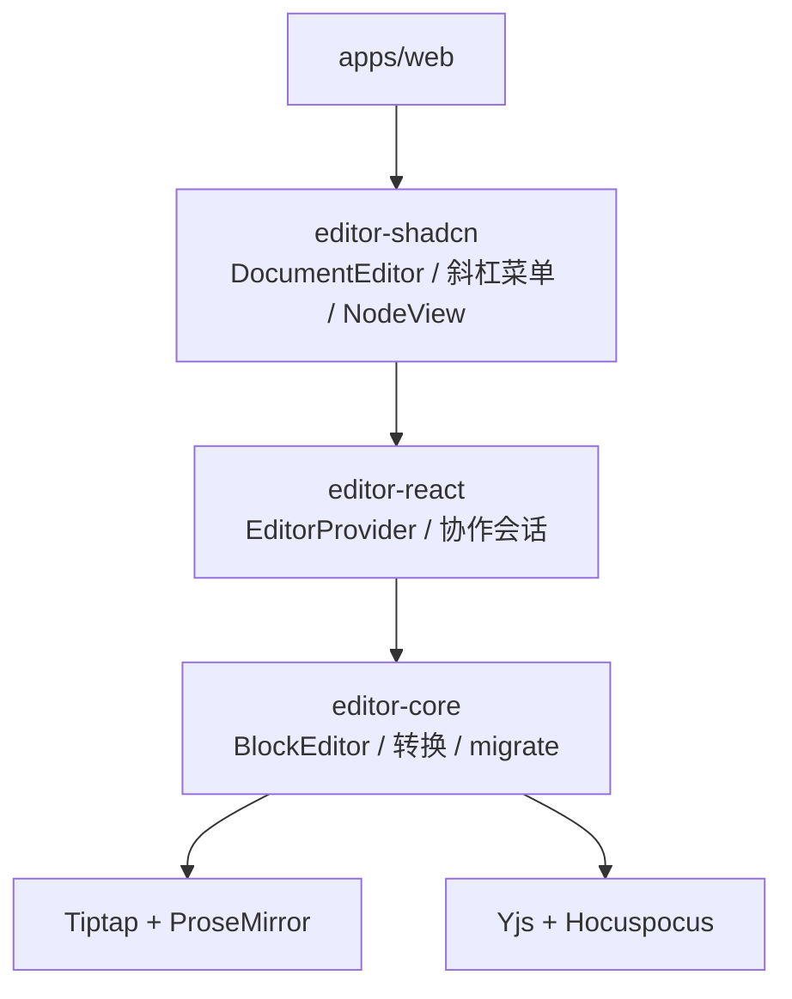
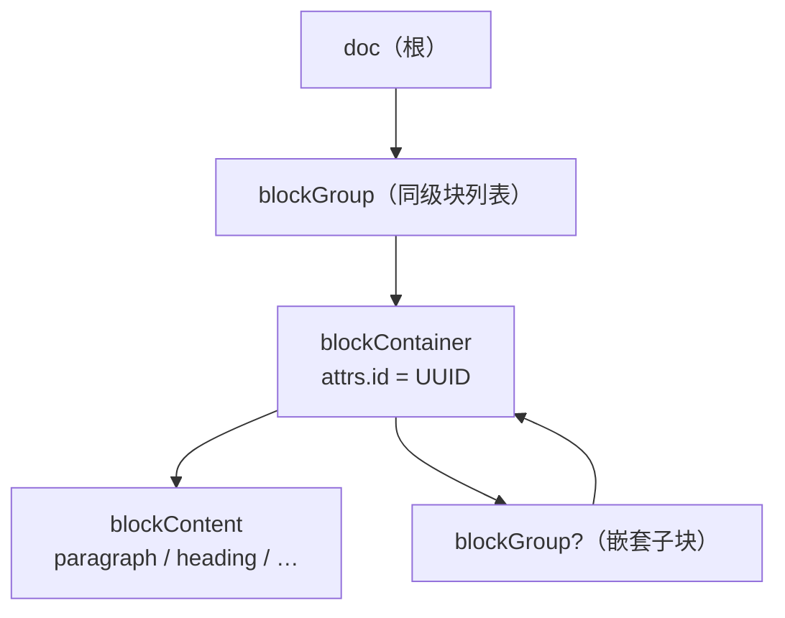
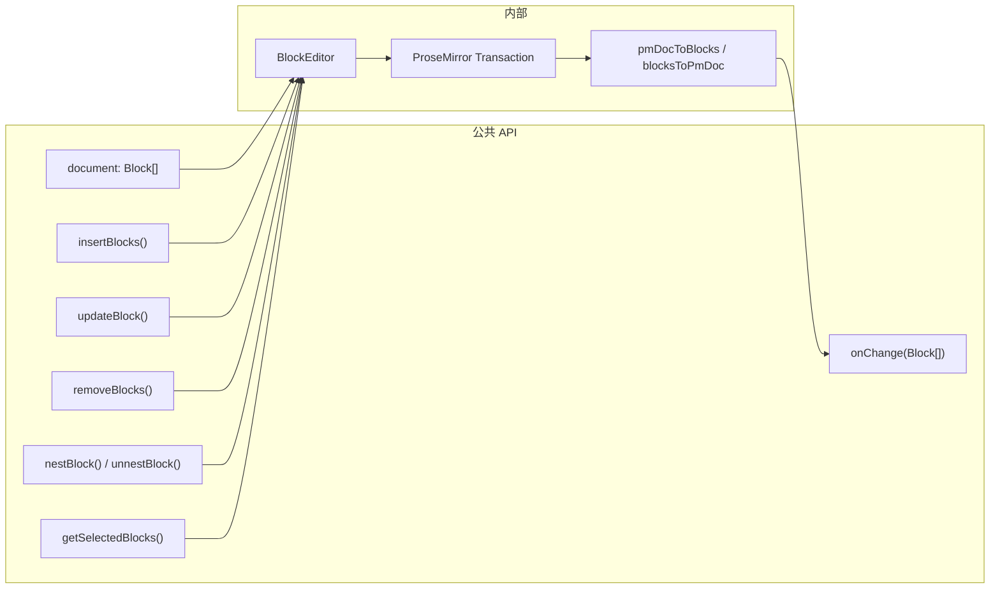
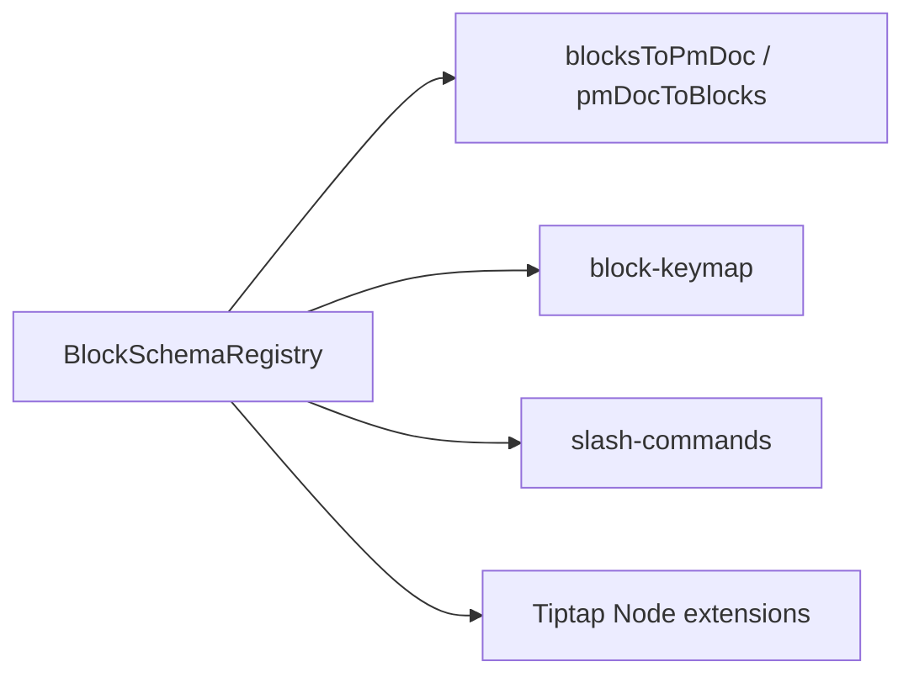
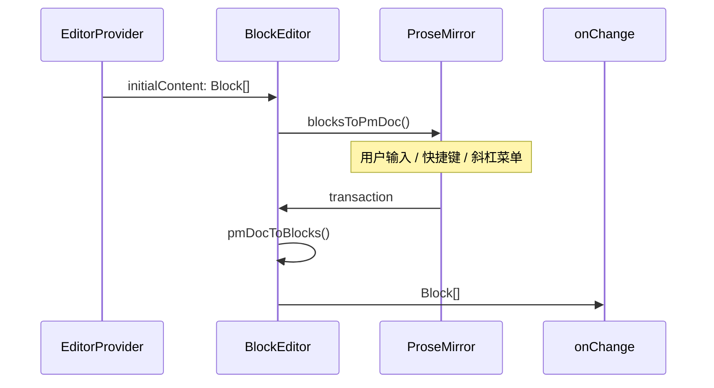
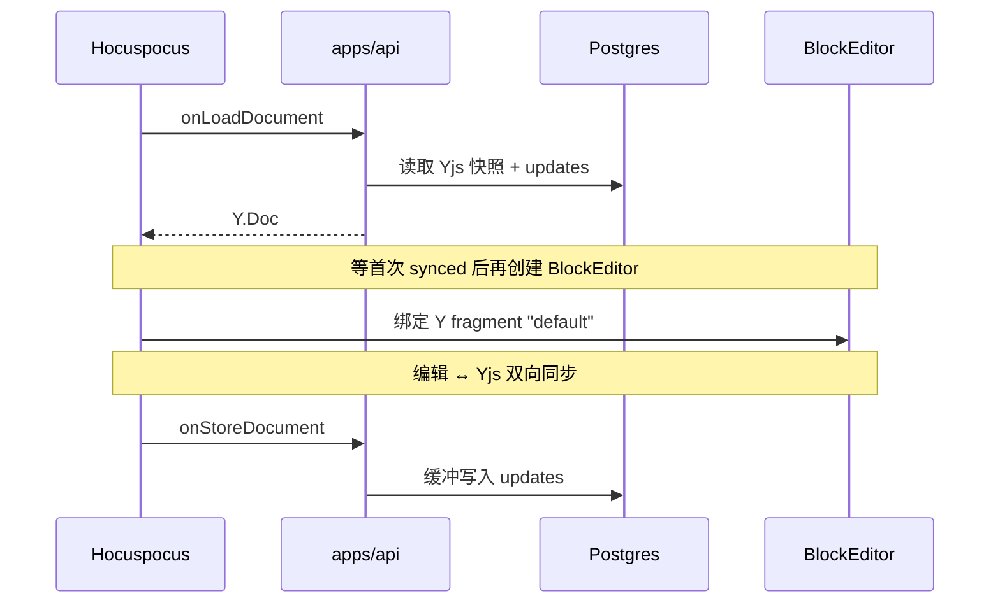
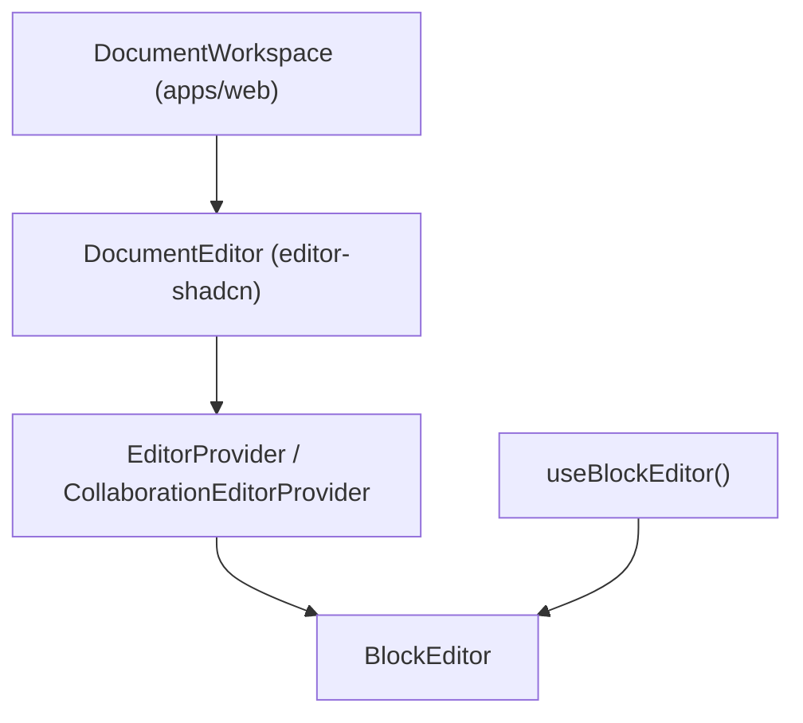

# 编辑器核心设计

**日期：** 2026-09-08  
**状态：** 当前实现  

本文总结 xtai-notion-open **编辑器核心**（`@xtai-notion/editor-core`）的设计思路：对外以 `Block[]` 为文档单位，对内基于 Tiptap + ProseMirror + Yjs 实现块树，经 `BlockEditor` 门面统一暴露块级 API。

> 完整架构（协作、React 栈、迁移）见 [块编辑器架构](./block-editor-architecture.md)。

---

## 1. 架构定位

| 维度 | 说明 |
|------|------|
| 对外文档单位 | `Block[]`（类 Notion 块 API） |
| 底层引擎 | Tiptap 3 + ProseMirror + Yjs |
| 持久化 | 协作层只存 Yjs 字节到 Postgres，不另存 `Block[]` JSON |
| 对外门面 | `BlockEditor` 类；Tiptap `Editor` 不暴露给应用层 |
| 内部 PM 树 | `blockGroup` → `blockContainer` → `blockContent` |

**关键源码：**

- `packages/editor-core/src/core/block-editor.ts` — 核心门面类
- `packages/editor-core/src/core/block-schema/types.ts` — `Block` / `InlineContent` 类型
- `packages/editor-core/src/core/block-schema/pm-nodes.ts` — PM 结构节点
- `packages/editor-core/src/core/block-schema/convert.ts` — `Block[]` ↔ PM 双向转换
- `packages/editor-core/src/core/schema/registry.ts` — 块 Spec 注册表
- `packages/editor-core/src/core/yjs-document.ts` — Yjs ↔ `Block[]` 工具
- `packages/editor-react/src/react/hooks/use-block-editor.ts` — React 获取门面实例

---

## 2. 包分层



| 包 | 职责 |
|---|---|
| `editor-core` | 纯 TypeScript：块 CRUD、PM 转换、斜杠命令、Markdown、AI 写入、Yjs 工具 |
| `editor-react` | React Provider、Hooks、`EditorContent` 包装 |
| `editor-shadcn` | shadcn UI、工具栏、块拖拽柄、图片/画板 NodeView |

**包边界约束：**

- `editor-core` 源码不得出现 `react`、`@tiptap/react`、`@workspace/ui`
- `apps/web` 通过 `editor-shadcn` / `editor-react` 消费编辑器，不直接依赖 Tiptap 公共 API
- `apps/api` 仅依赖 `editor-core`（含 `/migrate` 子路径做 v1→v2 迁移）

---

## 3. 双模型：对外 Block[]，对内 PM 树

### 3.1 对外块模型

每个块有稳定 UUID、类型、属性、行内/表格内容，以及嵌套子块：

```typescript
type Block = {
  id: string
  type: BlockType
  props: Record<string, unknown>
  content?: InlineContent[] | TableContent
  children: Block[]
}
```

**第一期块类型：** paragraph、heading、bulletListItem、numberedListItem、checkListItem、quote、codeBlock、divider、image、table、canvas。

提及、链接、粗斜体等属于**行内**（`InlineContent`），不是独立块类型。

### 3.2 内部 ProseMirror 树



- `blockContainer` 第一个子节点为 `blockContent`，可选第二个子节点为嵌套 `blockGroup`
- 每个 `blockContainer` 携带 UUID，协同、拖拽、`updateBlock(id)` 均针对该 id
- **转换层** `blocksToPmDoc` / `pmDocToBlocks` 是两种模型的唯一桥梁

---

## 4. BlockEditor 门面

`BlockEditor` 封装 Tiptap，对外暴露块级 API；`document` getter 实时将 PM 树转为 `Block[]`：



| API | 作用 |
|-----|------|
| `document` | 当前文档 → `Block[]` |
| `insertBlocks()` | 在指定块前/后/嵌套插入 |
| `updateBlock()` | 按 id 更新类型、props、content |
| `removeBlocks()` | 删除块 |
| `nestBlock()` / `unnestBlock()` | Tab / Shift+Tab 缩进逻辑 |
| `getSelectedBlocks()` | 选区对应的块 |
| `onChange()` | 订阅文档变更，回调 `Block[]` |

工具栏、斜杠菜单调用 `updateBlock` / `insertBlocks`，而非 `chain().setNode()`。嵌套、移动等通过 PM `Transaction` 直接修改文档树。

---

## 5. Schema Registry 扩展机制

块类型通过 **Spec 注册表** 统一管理；convert、keymap、slash 命令、Tiptap extensions 均从同一来源读取：



- 内置块经 `createDefaultBlockSchemaRegistry()` 注册
- `DocumentEditor` 可通过 `createEditorSchema({ override: { canvas, image } })` 注入带 React NodeView 的自定义块 spec
- `defineBlockSpec` + `propsToAttributes` 将块 props 映射为 PM 节点属性

---

## 6. 状态管理

**未使用 Redux / Zustand / reducer。** 状态分层如下：

| 层级 | 机制 | 关键位置 |
|------|------|----------|
| 文档真源 | ProseMirror `EditorState`（经 Tiptap） | `block-editor.ts` |
| 对外视图 | `BlockEditor.document` → `pmDocToBlocks()` | `block-editor.ts` |
| 变更订阅 | `onChange()` 监听 Tiptap `update` 事件 | `block-editor.ts` |
| React 订阅 | `useEditorBlocks`：`useState` + `onChange` | `editor-react` |
| 实例共享 | `EditorContext` | `editor-react` |
| 协作持久化 | Yjs `Y.Doc` + Hocuspocus WebSocket | `yjs-document.ts` |
| UI 局部状态 | 评论面板、AI 开关等 | `apps/web` 组件内 `useState` |

变更路径：

```
用户输入 → PM transaction → Tiptap update 事件 → pmDocToBlocks() → onChange(Block[])
```

---

## 7. 数据流

### 7.1 本地编辑



### 7.2 协作编辑



**关键时序：** 先等 Hocuspocus 首次 `synced`，再创建 `BlockEditor`，避免本地种子覆盖远端内容。

### 7.3 服务端只读

Postgres Yjs 字节 → `documentFromYjs()` → `Block[]`，用于摘要、提及收集、广场预览，无需启动完整编辑器。

---

## 8. React 层组合



| 组件 | 模式 |
|------|------|
| `EditorProvider` | 本地，`initialContent?: Block[]` |
| `CollaborationEditorProvider` | 协作，注入 Hocuspocus Provider |
| `DocumentEditor` | 统一入口，组合 Surface + 工具栏 + 提及 |

`DocumentEditor` 通过 `renderToolbar` / `renderSurface` / `renderSidePanel` 插槽组合业务 UI，避免 boolean prop 膨胀。

---

## 9. 交互与约束

| 操作 | 行为 |
|------|------|
| `/` 斜杠菜单 | 空块 → 变类型；有内容 → 下方插入 |
| Tab | 成为上一个同级的最后一个 child |
| Shift+Tab | 当前块 + children 提升到父块之后 |
| 拖拽把手 | 移动整个 `blockContainer`（含嵌套） |
| 最大嵌套深度 | 8（`MAX_NEST_DEPTH`） |

---

## 10. 设计要点

1. **门面隔离** — 应用只认识 `Block[]` 和 `BlockEditor`，底层 PM/Yjs 细节被封装。
2. **稳定 ID** — `blockContainer.attrs.id` 是协同、API、拖拽的共同锚点。
3. **单一转换层** — `blocksToPmDoc` / `pmDocToBlocks` 保证块 API 与 PM 树始终一致。
4. **Spec 可扩展** — 新块类型通过 Registry 注册，UI 层可 override NodeView。
5. **协作优先** — 持久化以 Yjs 为准；v1→v2 迁移在服务端 `onLoadDocument` 时完成。

---

## 11. 相关文档

- [块编辑器架构（完整版）](./block-editor-architecture.md)
- [块文档架构设计（详细规格）](./superpowers/specs/2026-08-28-block-document-architecture-design.md)
- [块文档架构实施计划](./superpowers/plans/2026-08-28-block-document-architecture.md)
