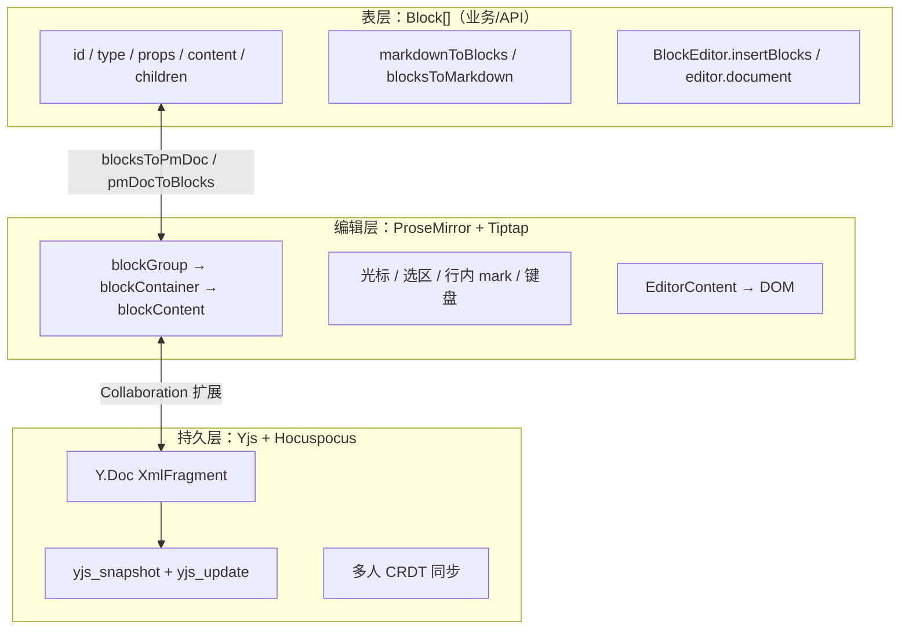

# 块模型与编辑器分层（面试总结）

**日期：** 2026-09-08  
**状态：** 当前实现  

本文面向面试与 onboarding，系统说明 xtai-notion-open 为何采用 **Block[] 表层 + ProseMirror 编辑层 + Yjs 持久化层** 的三层架构，以及 Markdown 导入后页面如何渲染。可与以下文档交叉阅读：

- [块编辑器渲染流水线面试题](./块编辑器渲染流水线面试题.md) — 用户输入 → PM → DOM，与 Block[] 分工
- [编辑器核心设计](./editor-core-design.md)
- [块编辑器架构](./block-editor-architecture.md)
- [文档导入导出实现](./文档导入导出实现.md)

---

## 1. 一句话结论（开场白）

> **Blocks 是面向产品和 API 的文档模型；ProseMirror 是编辑与渲染引擎；Yjs 是协作与持久化的真相源。**  
> 屏幕上的字不是 `blocks.map()` 画出来的，而是 PM 渲染 DOM；需要块数据时随时 `pmDocToBlocks` 读出来。

---

## 2. 三层模型



| 层级 | 是什么 | 谁在用 | 存不存库 |
|------|--------|--------|----------|
| **Block[]** | 类 Notion 的块 JSON 模型 | 导入/导出、AI、块 API、测试 | ❌ 不直接存 |
| **ProseMirror** | 通用文档树 + 编辑状态 | Tiptap、页面渲染、行内样式 | ❌ 内存态 |
| **Yjs** | CRDT 协作文档 | Hocuspocus、Postgres 快照 | ✅ 唯一持久化格式 |

---

## 3. 为什么要 Block[]，不直接用 PM？

### 3.1 产品语义 vs 引擎语义

业务讨论的是「段落块、标题块、嵌套子块」，不是「在 depth=3 的 blockContainer 后 insert paragraph」。Block[] 用 **UUID + type + props + children** 表达 Notion 式文档；PM 是通用富文本/块树引擎，没有「块」作为一等公民。

### 3.2 稳定边界（换引擎成本）

项目约定：

- `apps/web` 通过 `editor-shadcn` / `editor-react` 消费编辑器
- **应用层不直接依赖 Tiptap 公共 API**
- `BlockEditor` 是唯一门面

若全用 PM，导入、AI、搜索、广场阅读都要懂 schema 与 `Transaction`；升级 Tiptap 或换编辑器时改动面巨大。Block[] 是 **防腐层（Anti-Corruption Layer）**。

### 3.3 纯 JSON，服务端/Node 友好

`Block[]` 可在无 DOM、无 Editor 的环境使用：

- API：`markdownToBlocks` → `seedInitialContent`（`editor-core/server`）
- 测试：断言块结构，无需 mock PM
- AI：按块生成/替换，不碰光标

PM 必须挂 `Editor` + `schema`，不适合作为 API 层的默认交换格式。

### 3.4 与 BlockNote 同路线

Tiptap 生态的 BlockNote 同样是 **对外 Block API、对内 ProseMirror**。本项目的 `@xtai-notion/editor-core` 是同一类「块编辑器产品化」架构，而非裸 PM 编辑器封装。

---

## 4. 使用 Block[] 的核心优势（面试可逐条展开）

| 优势 | 说明 | 项目中的例子 |
|------|------|----------------|
| **语义清晰** | 文档 = 块树，和产品/设计对齐 | `Block.type`: paragraph、heading、table… |
| **API 稳定** | 上层不绑 PM/Tiptap 细节 | `insertBlocks`、`updateBlock`、`editor.document` |
| **可序列化** | 普通 JSON，跨端、跨进程 | Markdown 导入、`documentFromYjs` |
| **块级操作封装** | 不用手算 PM `pos` | `BlockEditor` 内部 `blocksToPmDoc` + transaction |
| **多消费方** | 同一份块逻辑服务多场景 | 导出 MD、AI 写稿、搜索纯文本、调试器 |
| **测试简单** | 结构化断言 | `markdown.test.ts`、`convert.test.ts` |
| **与持久化解耦** | 入库仍是 Yjs，块只是转换枢纽 | 导入：MD→Block→PM→Yjs |

### 4.1 Block[] 不负责什么（分工）

- ❌ 光标、选区、IME、键盘 — **PM**
- ❌ DOM 绘制 — **PM + NodeView（图片/画板）**
- ❌ 多人冲突合并 — **Yjs CRDT**
- ✅ 文档「长什么样」— **Block[]**

---

## 5. Block 与 PM 的结构对应

### 5.1 对外 Block 类型

```typescript
type Block = {
  id: string
  type: BlockType
  props: Record<string, unknown>
  content?: InlineContent[] | TableContent
  children: Block[]
}
```

第一期块类型：paragraph、heading、bulletListItem、numberedListItem、checkListItem、quote、codeBlock、divider、image、table、canvas。链接、粗体等属于 **行内** `InlineContent`，不是独立块。

### 5.2 对内 PM 树

```
doc (BlockDoc)
└── blockGroup
    └── blockContainer (attrs.id = Block.id)
        ├── paragraph / heading / ...  (blockContent)
        └── blockGroup (可选)
            └── blockContainer (子块 → Block.children)
```

**关键转换：**

- `blocksToPmDoc(blocks, schema)` — Block[] → PM Doc
- `pmDocToBlocks(doc)` — PM Doc → Block[]
- 源码：`packages/editor-core/src/core/schema/convert/`

### 5.3 `editor.document` 的含义

```typescript
get document(): Block[] {
  return pmDocToBlocks(this.editor.state.doc)
}
```

这是 **从当前 PM 状态反查** 的视图，不是渲染输入源。每次读取可能重新转换，勿假设与 PM 共享引用。

---

## 6. Markdown 导入：转换链与渲染链（高频面试题）

### 6.1 导入时（服务端）

```
Markdown
  → markdownToBlocks()          // parse.ts
  → Block[]
  → blocksToPmDoc()             // convert
  → PM JSON
  → TiptapTransformer.toYdoc() // createBlockSchemaYDoc
  → Y.Doc
  → Y.encodeStateAsUpdate()
  → Postgres (yjs_snapshot)
```

**入口代码：**

- 前端：`workspace-shell.tsx` → `POST /documents/import`
- API：`documents.service.importMarkdown()`
- 持久化：`yjs-persistence.service.seedInitialContent()`

**要点：入库的是 Yjs 二进制，不是 Block[] JSON，也不是 Markdown。**

### 6.2 打开文档页时（客户端渲染）

```
router.push(/documents/:id)
  → DocumentEditor + CollaborationEditorProvider
  → WebSocket → Hocuspocus onLoadDocument → 从 DB 加载 Yjs
  → 客户端 Y.Doc synced
  → BlockEditor（Y.Doc 非空 → applyInitialContent = false）
  → Tiptap Collaboration：Yjs ↔ PM 绑定
  → EditorContent：PM → DOM
```

**要点：**

- 导入后 **不会** 再用 Block[] 调用 `setContent`
- **渲染的不是 Block[]**，是 ProseMirror 文档
- 加载前 `EditorSurface` 显示 skeleton，等 `blockEditor` 就绪

### 6.3 对比：粘贴 Markdown（不新建文档）

编辑器内 Ctrl+V → `handleMarkdownPaste` → `markdownToBlocks` → `updateBlock` / `insertBlocks` → 改 PM → 协作层自动同步到 Yjs。路径与文件导入共用解析器，但不经过 `POST /documents/import`。

---

## 7. 常见面试问答

### Q1：Blocks 是表层，PM 是深层渲染，对吗？

**对。** 可补充第三层：Yjs 是持久化与协作的更底层。Blocks 描述「文档是什么」，PM 负责「怎么编辑和显示」，Yjs 负责「怎么存、怎么多人改」。

**输入到 DOM 的逐步说明：** 见 [块编辑器渲染流水线面试题](./块编辑器渲染流水线面试题.md)。

### Q2：既然有 PM，为什么导入还要先转 Block[]？

1. Markdown 解析的自然输出是「块列表」语义（标题、列表、代码块），不是 PM 节点树。  
2. 服务端没有 Editor 实例，Block[] 是纯数据，Node 可直接 `markdownToBlocks`。  
3. 与粘贴、导出、AI 共用同一套块模型，避免 MD→PM 与 MD→Block→PM 两套逻辑。

### Q3：能不能数据库直接存 Block[] JSON，不存 Yjs？

可以改架构，但会失去：

- Tiptap 官方协作扩展（Yjs binding）的开箱能力  
- CRDT 无冲突合并  
- 与 Hocuspocus 生态一致  

当前选型是 **Yjs 为唯一持久化格式**，Block[] 只做转换中间态。

### Q4：`createBlockSchemaYDoc` 做了什么？

`Block[]` → `blocksToPmDoc` → PM JSON → `TiptapTransformer.toYdoc` → 写入 `schemaVersion=2`。用于导入 seed、测试、从块初始化空 Y.Doc。

### Q5：协作模式下新建空文档和导入文档有何不同？

| 场景 | Y.Doc | BlockEditor 初始化 |
|------|-------|-------------------|
| 空文档 | XmlFragment 为空 | `applyInitialContent=true`，可用 starter blocks |
| 导入后 | 已有 snapshot | `applyInitialContent=false`，内容从 Yjs 同步进 PM |

### Q6：导出 Markdown 要不要经过 Yjs？

不需要写 Yjs。`blocksToMarkdown(editor.document)`，纯前端，`editor.document` 来自 `pmDocToBlocks`。

### Q7：这种分层的主要代价是什么？

- **双模型维护**：Block↔PM 转换必须正确，是核心测试重点  
- **性能**：频繁 `pmDocToBlocks` 有转换成本（通常按需读取）  
- **认知负担**：新人需理解三层，但长期换引擎、做导入导出更省心  

### Q8：和 Notion / BlockNote 的异同？

- **同**：块 API、块 ID、嵌套 children、PM 底层  
- **异**：自研 schema registry、Yjs v2 blockGroup、Markdown 自研解析器、画板 Excalidraw 块  

---

## 8. 设计权衡表（高级话题）

| 方案 | 优点 | 缺点 | 本项目 |
|------|------|------|--------|
| 全 PM，无 Block 层 | 少一层转换 | 业务/API/服务端全绑 PM | ❌ |
| Block 层 + PM | 产品语义清晰、边界稳定 | 需维护 convert | ✅ 当前 |
| 存 Block[] JSON 不存 Yjs | 直观、易 debug | 协作需自研 OT/CRDT | ❌ |
| Yjs 持久化 + Block 枢纽 | 协作成熟、导入灵活 | 三层概念 | ✅ 当前 |

---

## 9. 关键源码索引

```
# Block 模型与门面
packages/editor-core/src/core/block-schema/types.ts
packages/editor-core/src/core/block-editor.ts

# Block ↔ PM
packages/editor-core/src/core/schema/convert/index.ts
packages/editor-core/src/core/block-schema/pm-nodes.ts

# Yjs
packages/editor-core/src/core/yjs-document.ts
apps/api/src/collaboration/yjs-persistence.service.ts
apps/api/src/collaboration/hocuspocus-hooks.ts

# Markdown 导入
packages/editor-core/src/core/markdown/parse.ts
apps/api/src/documents/documents.service.ts  # importMarkdown

# 协作渲染
packages/editor-react/src/react/providers/collaboration-editor-provider.tsx
packages/editor-react/src/react/editor-content.tsx
packages/editor-shadcn/src/components/editor/editor-surface.tsx

# 前端导入入口
apps/web/components/inkspace/workspace-shell.tsx
apps/web/components/inkspace/toolbar.tsx
```

---

## 10. 面试表达模板（30 秒 / 2 分钟）

### 30 秒版

我们编辑器对外是 Notion 式的 **Block[] API**，对内用 **Tiptap/ProseMirror** 做编辑和 DOM，协作用 **Yjs** 存 Postgres。导入 Markdown 时先在服务端转成 Block，再转 PM 和 Yjs 快照；用户打开页面时从 Yjs 同步到 PM 渲染，**不是直接渲染 Block 数组**。Block 层的价值是稳定 API、服务端可处理、和 MD/AI 集成方便。

### 2 分钟版

在架构上我们刻意做了三层分离。最上层 **Block[]** 对齐产品语义：每块有 id、type、children，BlockEditor 暴露 insertBlocks、document 等 API，应用和 API 不直接碰 Tiptap。中间 **ProseMirror** 负责光标、选区、行内 mark 和 EditorContent 渲染。最底 **Yjs** 是持久化和协作的真相源，Hocuspocus 把 snapshot 存 Postgres。

为什么要有 Block？如果全用 PM，Markdown 导入、AI 写稿、单元测试都要依赖 Editor 和 schema，服务端很难做。Block 是纯 JSON，在 Node 里 markdownToBlocks 即可，和粘贴、导出共用模型。代价是要维护 blocksToPmDoc 双向转换，但这是可控的核心模块，测试覆盖也完整。

导入流程是：MD → Block → PM → Yjs 写库；打开文档是：Yjs 加载 → 协作同步 → PM → DOM。很多人误以为渲染 Block[]，实际是 PM 在画，editor.document 只是按需反查的视图。

---

## 11. 延伸阅读与自测

**自测题：**

1. 画出从「用户选 .md 文件」到「看见正文」的数据流。  
2. `seedInitialContent` 为何检查已有 snapshot？  
3. 什么情况下 `applyInitialContent` 为 false？  
4. 表格块导出 Markdown 为什么是占位注释？  
5. 若要做 PDF 导出，应基于 Block[]、PM DOM 还是 Yjs？（参考：[文档导入导出实现](./文档导入导出实现.md) 中 PDF 讨论）

**相关 OpenSpec / 设计：**

- `docs/interview/block-editor-architecture.md`
- `docs/interview/editor-core-design.md`
- `docs/yjs-常见问题.md`（若存在）

---

**文档维护：** 架构或导入链路变更时，同步更新本文第 6、9 节与源码路径。
