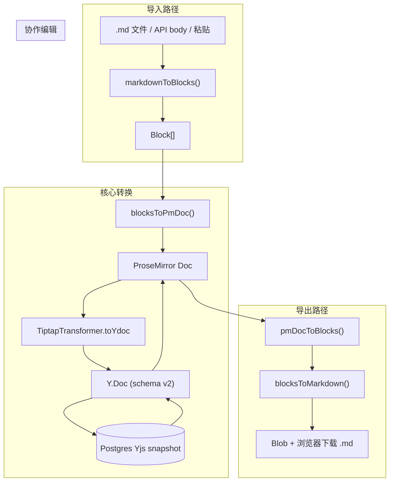

# 文档导入导出实现

**日期：** 2026-09-08  
**状态：** 当前实现  

本文总结 xtai-notion-open 中**文档导入/导出**相关能力的实现方式：以 **Markdown** 为文档级交换格式，以 **Block[] ↔ ProseMirror ↔ Yjs** 为内部转换中枢，并说明 UI 入口、API、编辑器内粘贴与已知限制。

> 块模型与 PM 树结构见 [编辑器核心设计](./editor-core-design.md)；整体协作架构见 [块编辑器架构](./block-editor-architecture.md)。

---

## 1. 能力一览

| 能力 | 格式 | 状态 | 说明 |
|------|------|------|------|
| 文档文件导入 | `.md` / `text/markdown` | ✅ | 顶栏按钮选文件 → API 建文档 |
| 文档导出 | Markdown (`.md`) | ✅ | 纯前端下载，无 export API |
| 编辑器粘贴 | Markdown 纯文本 | ✅ | `handleMarkdownPaste` |
| 编辑器输入 | 行首 Markdown 快捷键 | ✅ | `#`、`-`、`>`、`` ``` `` 等 |
| 图片导入 | JPEG/PNG/GIF/WebP | ✅ | 独立上传 API → COS |
| 画板导出 | PNG | ✅ | Excalidraw 单块导出 |
| 富文本 HTML 粘贴 | Word/网页 HTML | ❌ | 未映射到块 schema |
| 整文档导出 | HTML / PDF / DOCX | ❌ | 未实现 |
| 表格 Markdown 往返 | GFM 表格 | ⚠️ | 导入支持；导出为占位注释 |

**结论：** MVP 已完成 **Markdown 双向 + Yjs 持久化**；复杂块（表格、画板）导出仍不完整。

---

## 2. 架构总览



所有导入路径最终都落到 **Block[]**，再经 **blocksToPmDoc** 进入编辑器与协作层；导出则从当前 PM 文档反查 Block[] 再序列化。

---

## 3. 核心模块（`packages/editor-core`）

### 3.1 Markdown 解析与序列化（自研，无 remark/marked）

| 文件 | 导出 | 职责 |
|------|------|------|
| `src/core/markdown/parse.ts` | `markdownToBlocks()` | Markdown 文本 → `Block[]` |
| `src/core/markdown/serialize.ts` | `blocksToMarkdown()` | `Block[]` → Markdown 文本 |
| `src/core/markdown/paste.ts` | `handleMarkdownPaste()` | 剪贴板 Markdown → 块插入/替换 |
| `src/core/markdown/detect.ts` | `looksLikeMarkdown()` 等 | 判断是否按 Markdown 处理粘贴 |
| `src/core/markdown/index.ts` | — | 模块统一导出 |

**解析支持（`markdownToBlocks`）：**

- 标题 `#` ~ `###`
- 无序/有序/任务列表
- 引用 `>`、围栏代码块、分隔线 `---`
- GFM 管道表格（含单元格内粗体链接）
- 单行图片 ``
- 行内：`**bold**`、`*italic*`、`***both***`、`` `code` ``、`[text](url)`

**序列化限制（`blocksToMarkdown`）：**

- `table` → `<!-- table: export as plain text in future -->`
- `canvas` → `<!-- canvas -->`
- `numberedListItem` 一律输出 `1.`
- underline / strike / color 不输出
- mention 输出为 `@label`

### 3.2 Block ↔ ProseMirror 双向转换

| 文件 | 导出 | 职责 |
|------|------|------|
| `src/core/schema/convert/index.ts` | `blocksToPmDoc()` / `pmDocToBlocks()` | 转换主入口 |
| `src/core/schema/convert/block.ts` | — | 块容器 ↔ Block |
| `src/core/schema/convert/inline.ts` | — | 行内 marks ↔ InlineContent |
| `src/core/schema/convert/table.ts` | — | 表格 PM ↔ TableContent |
| `src/core/block-schema/convert.ts` | — | 薄 re-export |

`BlockEditor.document` getter 实时调用 `pmDocToBlocks(state.doc)`，导出按钮读到的就是当前文档块树。

### 3.3 Yjs 与持久化工具

| 文件 | 关键函数 | 职责 |
|------|----------|------|
| `src/core/yjs-document.ts` | `createBlockSchemaYDoc()` | Block[] → Y.Doc，写入 `schemaVersion=2` |
| | `documentFromYjs()` | Y.Doc → Block[] |
| | `documentToPlainText()` | 纯文本摘要（搜索等） |
| `src/core/migrate/migrate-ydoc.ts` | — | schema 版本读写（当前 v2，无内容级迁移逻辑） |

### 3.4 编辑器内粘贴链路

`packages/editor-core/src/core/block-editor.ts` 的 `handlePaste` 顺序：

1. **`handleTableBlockPaste()`** — 表格单元格内 Block JSON → 压成纯文本
2. **`handleMarkdownPaste()`** — 纯文本像 Markdown 则 `markdownToBlocks` 后 `updateBlock` / `insertBlocks`

粘贴边界：

- 代码块内不触发 Markdown 粘贴
- `looksLikeMarkdown` 要求行首块前缀或含 `` ``` ``；单行 `**bold**` 不算
- 空段落上粘贴：单块 replace；多块则 insert + remove 空段

### 3.5 Markdown 输入规则

`src/core/extensions/markdown-input-rules.ts`：行首输入 `# `、`- `、`> `、`` ``` `` 等自动转块类型（与粘贴共用同一套块模型）。

### 3.6 画板 PNG 导出

| 文件 | 函数 | 说明 |
|------|------|------|
| `src/core/canvas/canvas-export.ts` | `exportCanvasToBlob()` | 动态 import Excalidraw，支持 PNG/SVG |
| `packages/editor-shadcn/.../excalidraw-canvas-editor.tsx` | `exportPng()` | UI 触发下载 `canvas-{timestamp}.png` |

画板导出是**块级**能力，不属于整文档 Markdown 导出。

### 3.7 服务端安全入口

`packages/editor-core/src/server.ts` 供 `apps/api` 使用，导出：

- `markdownToBlocks`
- `createBlockSchemaYDoc`
- `documentFromYjs` 等

**不含** Excalidraw 等浏览器专用依赖，避免 Node 侧拉入前端大包。

---

## 4. API 层（`apps/api`）

### 4.1 Markdown 文件导入

**端点：** `POST /documents/import`  
**Controller：** `documents.controller.ts`  
**Service：** `documents.service.ts` → `importMarkdown()`

```typescript
// 简化流程
const blocks = markdownToBlocks(markdown)
const row = await documents.createForOwner(userId)
await documents.rename(row.id, title)
await yjsPersistence.seedInitialContent(row.id, blocks)
```

**`seedInitialContent`（`yjs-persistence.service.ts`）：**

- 若已有 snapshot 则跳过（幂等保护）
- `createBlockSchemaYDoc(blocks)` → `Y.encodeStateAsUpdate` → `insertSnapshot`

**请求体：** `{ title?: string, markdown?: string }`  
**依赖：** 协作持久化模块可用（`YjsPersistenceService`）

### 4.2 图片上传（辅助「导入」富内容）

| 方法 | 路径 | 说明 |
|------|------|------|
| `POST` | `/documents/:id/images` | multipart 上传至 COS（10MB 限制） |
| `POST` | `/documents/:id/images/presign` | 预签名上传 |
| `GET` | `/documents/:id/images/proxy` | 代理远程图片（画板导出内联用） |

Markdown 中的 `` 导入后只保留 URL 字符串，不会自动拉取上传。

### 4.3 无服务端导出

Markdown 导出完全在浏览器完成，**没有** `GET /documents/:id/export` 之类接口。

---

## 5. 前端 UI 入口（`apps/web`）

### 5.1 Markdown 文件导入

| 组件 | 路径 | 行为 |
|------|------|------|
| 顶栏「导入」 | `components/inkspace/toolbar.tsx` | 触发隐藏 file input |
| 导入逻辑 | `components/inkspace/workspace-shell.tsx` | `importMarkdownFile()` |

**用户流程：**

```
点击「导入」
  → <input accept=".md"> 选文件
  → file.text()
  → POST /documents/import { title, markdown }
  → refreshDocuments() + router.push(/documents/:id)
```

标题默认取文件名（去掉 `.md` 后缀）。

### 5.2 Markdown 导出

| 组件 | 路径 | 行为 |
|------|------|------|
| `MarkdownExportButton` | `components/inkspace/markdown-export-button.tsx` | 固定工具栏按钮 |
| 挂载位置 | `components/inkspace/fixed-toolbar.tsx` | 编辑时可见 |

**用户流程：**

```
点击「导出 Markdown」
  → blocksToMarkdown(editor.document)
  → new Blob + <a download>
  → toast 成功/失败
```

默认文件名 `document.md`，可通过 props 传入文档标题。

### 5.3 其它相关入口

- **Ctrl+V**：走 `BlockEditor.handlePaste`（Markdown + 表格 JSON）
- **行首 `# ` 等**：Markdown 输入规则
- **图片块 NodeView**：拖拽/选择上传（`image-upload-node.tsx`）
- **Excalidraw 画板**：块内「导出 PNG」

---

## 6. 三条典型数据流

### 6.1 文件导入 → 协作编辑

```
用户选 .md
  → workspace-shell: POST /documents/import
  → markdownToBlocks(markdown)
  → createForOwner + seedInitialContent
      → blocksToPmDoc → TiptapTransformer.toYdoc
      → Yjs snapshot 写入 DB
  → 前端打开 /documents/:id
  → Hocuspocus 加载 Y.Doc，编辑器渲染
```

### 6.2 当前文档导出

```
用户点「导出 Markdown」
  → editor.document (= pmDocToBlocks)
  → blocksToMarkdown(blocks)
  → 客户端下载 .md
```

### 6.3 编辑器内粘贴 Markdown

```
Ctrl+V
  → handleTableBlockPaste（优先）
  → handleMarkdownPaste
      → looksLikeMarkdown(plain)?
      → markdownToBlocks(plain)
      → updateBlock / insertBlocks
```

---

## 7. 依赖与技术选型

| 层级 | 依赖 | 用途 |
|------|------|------|
| Markdown 解析/序列化 | **自研**（正则 + 行扫描） | 无 unified/remark/marked |
| 块 ↔ PM | Tiptap 3 + ProseMirror | schema、转换、输入规则 |
| 协作持久化 | Yjs + @hocuspocus/transformer | snapshot 存 Postgres |
| 画板导出 | @excalidraw/excalidraw（动态 import） | PNG blob |
| 图片存储 | COS + Nest 上传模块 | 图片块 URL |
| AI 面板渲染 | react-markdown + remark-gfm | **仅** AI 助手 UI，与文档导入导出无关 |

---

## 8. 已知限制与扩展方向

### 8.1 导入

- 不支持 h4+ 标题、嵌套列表语义、HTML 文件
- 行内 underline / strike / color / mention 在 Markdown 导入中不解析
- 富文本 HTML 粘贴无法映射到块 schema（注释见 `paste.ts`）
- 嵌套 children 在 MD 解析中扁平化为同级块

### 8.2 导出

- 表格、画板仅为 HTML 注释占位，**不能**无损 round-trip
- 有序列表序号不保留
- 部分行内样式丢失

### 8.3 Schema 迁移

- 当前 `schemaVersion = 2`
- 旧版本 Y.Doc 加载时**仅 warn**，无自动内容迁移

### 8.4 合理扩展路径

1. 在 `serialize.ts` / `parse.ts` 补全 **table / canvas** 的 GFM 或自定义语法
2. 引入 **remark/unified** 统一 MD 管线，减少自研解析边界 case
3. 增加 **HTML → Block[]** 粘贴适配层（Word/Notion 迁移）
4. 服务端 **export API**（批量、权限审计、异步 PDF 等）

---

## 9. 测试覆盖（行为参考）

| 测试文件 | 覆盖点 |
|----------|--------|
| `packages/editor-core/test/core/markdown.test.ts` | MD ↔ Block 往返、行内 mark |
| `packages/editor-core/test/core/markdown-paste.test.ts` | 粘贴场景 |
| `packages/editor-core/test/core/markdown-table.test.ts` | GFM 表格 + Yjs roundtrip |
| `packages/editor-core/test/core/block-schema/convert.test.ts` | blocksToPmDoc 往返 |
| `apps/api/test/documents/markdown-import-inline.spec.ts` | 服务端导入 + 快照 |

---

## 10. 关键源码索引

```
packages/editor-core/src/core/markdown/     # 解析、序列化、粘贴、检测
packages/editor-core/src/core/schema/convert/  # Block[] ↔ PM
packages/editor-core/src/core/yjs-document.ts
packages/editor-core/src/core/block-editor.ts  # handlePaste
packages/editor-core/src/core/canvas/canvas-export.ts
packages/editor-core/src/server.ts          # API 可用导出

apps/api/src/documents/documents.service.ts # importMarkdown
apps/api/src/documents/documents.controller.ts  # POST /documents/import
apps/api/src/collaboration/yjs-persistence.service.ts  # seedInitialContent

apps/web/components/inkspace/workspace-shell.tsx   # 文件导入
apps/web/components/inkspace/markdown-export-button.tsx  # MD 导出
apps/web/components/inkspace/toolbar.tsx           # 导入按钮
apps/web/components/inkspace/fixed-toolbar.tsx     # 导出按钮挂载
```

---

**面试要点速记：**

1. **交换格式**是 Markdown，**内部真相**是 Yjs snapshot（经 Block[] / PM 转换）。
2. **导入**走 API 落库；**导出**纯前端，读 `editor.document` 序列化。
3. **粘贴**与**文件导入**共用 `markdownToBlocks`，保证行为一致。
4. **表格/画板/富文本**是主要缺口；扩展应优先补 serialize/parse 或引入 remark 管线。
