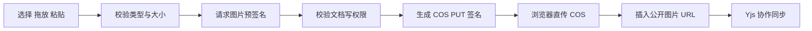

# 编辑器图片上传与腾讯云 COS 设计

## 背景

当前编辑器基于 Tiptap 和 Yjs 协作，已有文本、链接、任务列表、拖放光标等扩展，但没有图片节点或对象存储上传链路。本功能为协作文档增加图片资源上传能力，使用腾讯云 COS 存储图片，浏览器直传对象存储，文档内容仅保存最终公开图片 URL。

## 已确认范围

- 上传入口：工具栏文件选择、编辑区拖拽、剪贴板粘贴。
- 支持格式：JPG、PNG、GIF、WebP。
- 单张大小上限：10MB。
- 上传状态：上传中、成功、失败。
- 失败操作：重试、删除本地上传预览。
- 图片展示：最大宽度自适应编辑器内容区域，保留原始宽高比例。
- 不包含：裁剪、压缩、图库、尺寸拖拽、服务端删除和孤立对象清理。
- 上传必须绑定 `documentId`，仅 owner/editor 可以上传。
- 图片按文档分目录存储。
- 从文档删除图片只删除编辑器节点，不立即删除 COS 对象，避免协作历史或撤销引用失效。

## 方案选择

采用 API 生成预签名 PUT URL、浏览器原生 `fetch` 直传 COS 的方案。

### 方案 A：预签名 PUT，推荐

API 校验用户文档写权限和文件元数据，生成不可由客户端指定的对象 Key，并返回一次性 PUT URL。浏览器直接向 COS 上传，成功后将公开资源 URL 插入 Tiptap 图片节点。

优点：服务端不承载图片流量；前端不持有腾讯云密钥；依赖少；上传过程容易测试和隔离。上传状态只存在客户端，不污染 Yjs。

### 方案 B：预签名 POST 表单

API 返回 POST 表单字段，浏览器通过 `FormData` 上传。

优点：可以通过表单策略表达更多上传条件。缺点：字段和错误处理更复杂，本项目的单文件 PUT 场景收益有限。

### 方案 C：临时密钥加 COS SDK

API 发放临时密钥，浏览器使用腾讯云 SDK 管理上传。

优点：可扩展分片、断点续传和更丰富的进度能力。缺点：增加 SDK 依赖和临时密钥治理复杂度，当前 10MB 上限不需要这些能力。

## 架构

### 后端模块

新增 COS 上传模块，职责限定为：

1. 读取服务端环境变量中的 COS 配置。
2. 复用 `DocumentsService.assertCanWrite(documentId, userId)` 做权限校验。
3. 校验 MIME 类型和文件大小声明。
4. 生成 `documents/{documentId}/{uuid}.{extension}` 对象 Key。
5. 使用服务端 COS SDK 以固定 `Content-Type` 写入对象。
6. 返回公开资源 URL、对象 Key 和 Content-Type。

新增接口：

```text
POST /documents/:documentId/images/presign
```

请求头沿用当前开发身份约定：

```text
x-dev-user-id: <user-id>
```

请求体：

```json
{
  "contentType": "image/png",
  "size": 123456
}
```

响应体：

```json
{
  "uploadUrl": "https://<bucket>.cos.<region>.myqcloud.com/<object-key>?<signature>",
  "publicUrl": "https://<public-base-url>/<object-key>",
  "objectKey": "documents/<document-id>/<uuid>.png",
  "contentType": "image/png"
}
```

API 不接受客户端传入对象 Key 或公开 URL。服务端使用 `COS_SECRET_ID` 和 `COS_SECRET_KEY` 签名，密钥不得进入浏览器 bundle、API 响应或日志。

### 前端模块

上传适配器放在 Web 工作区层，由工作区将 `documentId`、`user.id`、`apiUrl` 和上传函数传入编辑器。`@workspace/editor` 只依赖抽象的上传接口，不依赖腾讯云、COS SDK 或应用 API 路由。

编辑器扩展负责：

- 注册 Tiptap Image 节点。
- 处理工具栏文件选择、编辑器 drop 和 paste 事件。
- 统一执行类型/大小校验、预览占位、上传、成功替换和失败恢复。
- 将最终公开 URL 插入图片节点。
- 将上传中和失败状态保持在客户端视图层，不写入协作文档。

上传预览视觉结构参考 `Attachment` 组件的状态化附件结构，包含缩略图、文件名、状态文案和操作按钮。成功后切换为普通图片节点。

## 数据流



完整流程：

1. 用户从工具栏选择文件，或在编辑区拖放/粘贴图片。
2. 客户端逐文件校验 MIME、扩展名和 10MB 上限；非法文件不请求 API，并显示可理解的错误。
3. 编辑器在当前光标位置创建本地上传预览，并记录原始 `File`、位置标识和重试所需状态。
4. 前端将原始文件以 `multipart/form-data` 提交到 `POST /documents/:documentId/images`。
5. API 校验当前身份对文档拥有 owner/editor 权限、MIME 类型和大小后，使用 COS SDK 上传。
6. API 返回公开 URL，前端将本地预览替换成最终图片节点。
7. 最终图片节点通过 Tiptap/Yjs 同步给其他协作者。

## 交互与状态

### 状态

- `uploading`：展示本地缩略图、文件名和处理中状态；禁止重复提交同一预览。
- `done`：移除上传控制，展示图片节点。
- `error`：保留缩略图和文件名，展示错误信息，并提供重试和删除。

### 失败处理

以下情况均进入 `error` 状态：

- 本地类型或大小校验失败。
- 预签名接口返回非成功状态。
- COS PUT 网络错误或返回非成功状态。
- 返回 URL 缺失或不是有效的公开 URL。

重试复用原始 `File` 和同一预览位置，重新请求预签名；不复用过期签名 URL。删除只移除本地预览，不调用 COS 删除接口。

### 协作边界

上传期间不把临时 URL、blob URL 或上传状态写入 Yjs。上传成功后才插入最终图片节点。

上传完成时需要确认原始插入位置仍然存在且未被其他协作者删除或替换；若位置已失效，不覆盖他人的内容，应将结果插入当前有效光标位置或让本地预览进入可删除的失败状态，并给出明确提示。该行为需要通过编辑器事务和位置映射实现并覆盖测试。

## COS 配置

服务端环境变量：

```text
COS_SECRET_ID=<腾讯云密钥 ID>
COS_SECRET_KEY=<腾讯云密钥 Key>
COS_BUCKET=<存储桶名称>
COS_REGION=<地域，例如 ap-guangzhou>
# 可选：COS_PUBLIC_BASE_URL=<公开对象或 CDN 基础 URL>
```

未设置 `COS_PUBLIC_BASE_URL` 时，服务端使用
`https://<COS_BUCKET>.cos.<COS_REGION>.myqcloud.com` 生成公开对象 URL。
设置它可改用 CDN 或自定义公开域名，且不应带末尾斜杠；服务端会安全拼接对象 Key。

### 最小权限

签名服务使用的腾讯云账号或子账号仅授予目标存储桶图片前缀的 `PutObject` 权限，例如 `documents/*`。不授予浏览器任何腾讯云密钥，不在服务端日志打印签名 URL，不授予本功能不需要的删除、列举或管理权限。

### COS CORS

图片由 API 服务端上传，浏览器不会直接请求 COS，因此上传功能不需要存储桶为 Web Origin 配置 `PUT` 的 CORS 规则。若后续改回浏览器直传，必须为开发和生产 Web Origin 精确配置 `PUT`、`HEAD` 和 `Content-Type`，并暴露 `ETag`。

- `MaxAgeSeconds`：可设置为 600 或更高的合理缓存时间。

## 错误语义

API 对无权限请求返回 403；文档不存在或无成员关系不应泄露额外资源信息。格式不支持返回 400，文件过大返回 413，COS 配置缺失或签名失败返回 500，并在服务端记录不包含密钥和签名参数的结构化错误。

前端将 API 错误映射为用户可理解的文案：无权限、文件格式不支持、文件超过 10MB、上传失败、网络不可用。不会把原始腾讯云签名 URL 或服务端堆栈展示给用户。

## 测试设计

### API

- owner 可以获取签名。
- editor 可以获取签名。
- viewer 获取签名返回 403。
- outsider 获取签名返回 403。
- 未知 `documentId` 返回合适的错误。
- 不支持的 MIME 类型返回 400。
- `size > 10MB` 返回 413。
- 响应包含 upload URL、公开 URL、object Key 和固定 Content-Type。
- object Key 始终以目标 documentId 前缀开头，不能由客户端注入路径。
- COS 配置缺失时不会生成伪造响应，且错误日志不包含密钥。

### 编辑器

- 文件选择会调用上传适配器。
- drop 和 paste 只处理图片文件，并阻止浏览器默认导航行为。
- 不支持的格式和超限文件不会请求上传接口。
- 上传开始时只出现本地预览，不产生图片节点或协作更新。
- 上传成功后插入正确的 Image 节点和公开 URL。
- 上传失败后显示重试和删除操作。
- 重试重新获取签名并复用原始 File。
- 删除移除本地预览且不调用 COS 删除。
- 上传位置失效时不会覆盖协作者内容。
- viewer 编辑器不显示上传入口或拒绝执行上传。

### Web 工作区

- 预签名请求包含当前文档 ID、Content-Type、文件大小和当前用户身份头。
- API URL 尾部斜杠不会造成重复斜杠。
- 上传成功后公开 URL 被传递到编辑器，而不是签名 URL。
- API、COS 网络错误能转化为稳定的用户提示。

## 验收标准

1. owner/editor 可以从工具栏、拖放和粘贴上传符合要求的图片。
2. 上传过程中用户能看到本地预览和处理中状态。
3. 上传成功后图片展示在编辑器中并可被协作者看到。
4. viewer、非成员、超限文件和不支持格式均被阻止。
5. 上传失败时可以重试或删除，不会留下损坏图片节点。
6. 腾讯云密钥只存在 API 服务端，浏览器只接触一次性预签名 URL。
7. 文档内容只保存最终公开 URL，删除图片不会触发 COS 删除。
8. COS CORS、环境变量和最小权限配置均有文档说明。
