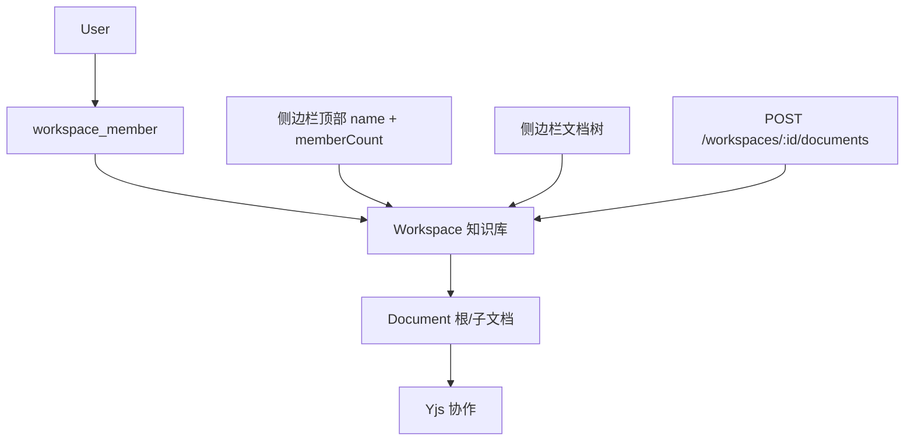

# 知识库（Workspace）系统设计

**日期：** 2026-09-09  
**状态：** 已确认  
**范围：** P0 知识库 CRUD、库级成员与权限继承、侧边栏联动、历史数据迁移

## 目标

让用户可以创建**知识库**（复用现有 `workspace` 表），在同一知识库下管理多篇文档。侧边栏顶部展示当前知识库名称与成员数量（替换硬编码「栖木工作室 · 6 位成员」），「新建文档」在**当前知识库**下创建。

用户已确认权限模型：**知识库级成员**——加入知识库即拥有库内全部文档的对应角色。

## 背景与现状

| 层级 | 现有结构 | 当前问题 |
|------|----------|----------|
| 知识库 | `workspace` 表（id, name, created_at） | 每新建一篇文档就 `INSERT workspace`，语义错误 |
| 文档 | `document.workspace_id` + `document.parent_id` | `parent_id` 文档树已可用；`workspace_id` 未在前端使用 |
| 成员 | `document_member`（按文档） | 侧边栏成员数为假数据；权限按文档校验 |
| UI | `sidebar.tsx` 顶部硬编码 | 名称、成员数、头像字母均为静态 |

`DocumentMetadata` 已含 `workspaceId`，但 `apps/web` 未消费该字段。

## 架构与数据流



1. 用户登录后 `GET /workspaces` 获取所属知识库列表。
2. 前端持久化 `currentWorkspaceId`（`localStorage`: `inkspace:workspace:v1`）。
3. `GET /workspaces/:id/documents` 拉取该库文档树；侧边栏仅渲染此列表。
4. 打开 `/documents/:id` 时，从文档 metadata 反查 `workspaceId`，同步侧边栏当前库。
5. 访问文档 / 协作连接时，先查 `workspace_member.role`，再映射为文档角色。

## 数据模型

### 变更 `workspace` 表

| 列 | 类型 | 说明 |
|----|------|------|
| `id` | UUID PK | 不变 |
| `name` | TEXT NOT NULL | 知识库名称 |
| `created_by` | UUID FK → app_user | **新增**，创建者 |
| `created_at` | TIMESTAMPTZ | 不变 |
| `updated_at` | TIMESTAMPTZ | **新增**，默认 NOW() |

### 新增 `workspace_member` 表

| 列 | 类型 | 说明 |
|----|------|------|
| `workspace_id` | UUID FK → workspace | 级联删除 |
| `user_id` | UUID FK → app_user | 级联删除 |
| `role` | TEXT NOT NULL | `owner` \| `admin` \| `editor` \| `viewer` |
| `created_at` | TIMESTAMPTZ | 默认 NOW() |

主键：`(workspace_id, user_id)`。索引：`user_id`。

### `document` 表

- `workspace_id`：必填，归属知识库（已有）。
- `parent_id`：库内文档树，不变；**约束**：子文档 `workspace_id` 必须等于父文档。

### `document_member` 表（P0）

- **保留**，只读兼容分享链接等历史路径。
- P0 不再为新文档写入 `document_member`；权限以 `workspace_member` 为准。
- `assertCanRead` 优先查 `workspace_member`，查不到时 fallback `document_member`（兼容旧分享数据）。

### 角色映射

| workspace_member.role | 文档读 | 文档写 | 管理库 / 邀请成员 |
|-----------------------|--------|--------|-------------------|
| owner | ✅ | ✅ | ✅ |
| admin | ✅ | ✅ | ✅（不可删库、不可降级 owner） |
| editor | ✅ | ✅ | ❌ |
| viewer | ✅ | ❌ | ❌ |

映射到现有 `DocumentRole` 时：`owner`→`owner`，`admin`/`editor`→`editor`，`viewer`→`viewer`（对外 API 仍返回三档 `owner|editor|viewer`；库内 `admin` 在 metadata 中可保留或通过 `workspaceRole` 字段暴露）。

## API 设计

### Workspaces

| 方法 | 路径 | 说明 |
|------|------|------|
| `GET` | `/workspaces` | 当前用户所属知识库列表（含 `memberCount`、`role`） |
| `POST` | `/workspaces` | 创建 `{ name: string }`；创建者为 `owner` |
| `GET` | `/workspaces/:id` | 详情 |
| `PATCH` | `/workspaces/:id` | 重命名 `{ name }`（owner/admin） |
| `GET` | `/workspaces/:id/members` | 成员列表 |
| `POST` | `/workspaces/:id/members` | 邀请 `{ userId, role }`（owner/admin） |
| `DELETE` | `/workspaces/:id/members/:userId` | 移除成员（owner/admin；不可移除末位 owner） |
| `GET` | `/workspaces/:id/documents` | 该库下未删除文档列表（同现有 `DocumentMetadata` 形状） |
| `POST` | `/workspaces/:id/documents` | 新建根文档；可选 `{ parentId }` 建子文档 |

### Documents（兼容）

| 方法 | 路径 | P0 行为 |
|------|------|---------|
| `POST` | `/documents` | 在用户**默认知识库**（最近使用或首个 owner 库）下创建；**不再**新建 workspace |
| `GET` | `/documents` | 可选 `?workspaceId=` 过滤；无参数时返回用户可访问的全部文档（保持搜索/收藏兼容） |
| 其余 | 不变 | 权限校验改为 workspace 优先 |

### 响应类型（节选）

```ts
type WorkspaceRole = "owner" | "admin" | "editor" | "viewer"

interface WorkspaceSummary {
  id: string
  name: string
  memberCount: number
  role: WorkspaceRole
  createdAt: string
  updatedAt: string
}

interface WorkspaceMemberView {
  userId: string
  displayName: string
  color: string
  role: WorkspaceRole
}
```

## 前端改造

### 侧边栏顶部（`sidebar.tsx`）

- Props 新增：`workspace: { id, name, memberCount }`、`workspaces`、`onSwitchWorkspace`、`onCreateWorkspace`。
- 替换硬编码「栖木工作室 / PRO · 6 位成员」为 API 数据。
- 头像 fallback 取知识库名称首字。
- 点击 `ChevronsUpDownIcon` 打开下拉：切换知识库 +「新建知识库」。

### 状态（`workspace-shell.tsx`）

- `currentWorkspaceId` + `localStorage` 持久化。
- `refreshWorkspaces()` 与 `refreshDocuments(workspaceId)` 分离。
- `createDocument()` → `POST /workspaces/:currentWorkspaceId/documents`。
- `createChildDocument(parentId)` → 同上带 `parentId`。
- 打开文档时：若 `document.workspaceId !== currentWorkspaceId`，自动切换当前库。

### 路由

- **P0 保持** `/documents/[documentId]`，不强制改 URL。
- **`/workspaces`**：知识库列表总览（多库团队管理）。
- **`/workspaces/[workspaceId]`**：库首页（文档列表 + 新建入口）。

### 新建知识库 UI

- 对话框：输入名称 → `POST /workspaces` → 切换为当前库 → 刷新列表。

## 历史数据迁移

迁移文件：`007_workspace_members/migration.sql`

1. `ALTER TABLE workspace` 增加 `created_by`、`updated_at`。
2. `CREATE TABLE workspace_member`。
3. **按文档 owner 合并 workspace**：
   - 对每个 `owner_id` 非空的用户，若尚无其 owner 知识库，则创建 `name = '我的知识库'` 的 workspace。
   - 将该用户 `owner_id` 对应的所有 `document.workspace_id` 更新为该库。
   - 插入 `workspace_member (owner)`。
4. **协作成员回填**：对仍存在 `document_member` 且非 workspace owner 的记录，按文档所在 `workspace_id` 插入 `workspace_member`（同用户多文档取最高权限：`owner > admin > editor > viewer`）。
5. **清理**：删除没有任何 document 引用的 orphan `workspace` 行。
6. `owner_id` 为空的文档：归入第一个 `document_member.owner` 的 workspace，或创建「未分类」库（迁移脚本中按实际数据二选一，以不丢数据为准）。

迁移后执行：`pnpm --filter api prisma migrate deploy` 并 `prisma generate`。

## 错误处理

| 场景 | HTTP | 文案（中文） |
|------|------|--------------|
| 非库成员访问库/文档 | 403 | 不是该知识库成员 |
| viewer 写入 | 403 | 查看者无法编辑 |
| 非 owner/admin 改库名/邀人 | 403 | 无权管理该知识库 |
| 移除末位 owner | 409 | 知识库至少保留一名所有者 |
| 子文档 parent 跨库 | 400 | 子文档必须与父文档在同一知识库 |
| 库不存在 | 404 | 知识库不存在 |

## 测试范围

### API（Vitest）

- 创建知识库：创建者自动 `owner`，memberCount = 1。
- 在指定库下创建文档：不再产生新 workspace；`workspace_id` 正确。
- 子文档继承父文档 `workspace_id`。
- `assertCanRead` / `assertCanWrite`：workspace_member 生效；document_member fallback。
- 列表：`GET /workspaces/:id/documents` 仅返回该库文档。
- 迁移脚本：fixture 数据合并后文档数不变、无 orphan workspace。

### Web（Vitest + Testing Library）

- 侧边栏展示 API 返回的名称与成员数。
- 切换知识库后文档列表刷新。
- 新建文档 POST 路径含 `currentWorkspaceId`。
- 新建知识库后自动切换并清空/加载对应文档树。

## 分期

| 阶段 | 内容 |
|------|------|
| **P0（本 spec）** | 迁移、workspace CRUD、库级权限、侧边栏联动、按库建文档 |
| **P1** | 成员邀请 UI（邮箱/用户搜索）、角色管理、成员列表页 — **已实现** |
| **P1.5** | `/workspaces` 列表页 + `/workspaces/:id` 库首页 + `documentCount` — **已实现** |
| **P2** | 分享链接改为写入 `workspace_member`；移除 `document_member` 写入路径 — **已实现** |

## 非目标（P0）

- 知识库嵌套（库中库）
- 公开/私有知识库、SSO、审计日志
- 修改 URL 为 `/w/:wid/d/:did`（可后续迭代）
- 飞书 / 第三方同步
