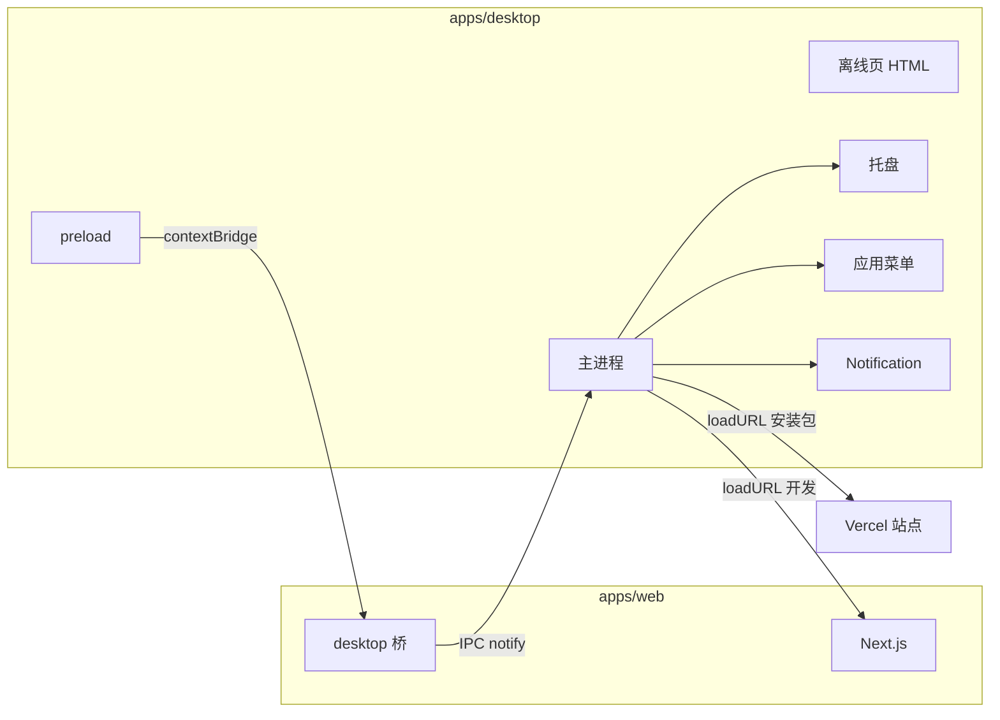

# Electron 桌面壳（Forge）设计

**日期：** 2026-09-10  
**状态：** 已确认  
**范围：** 用 Electron Forge 包裹现有 `apps/web`，Windows 第一版；托盘、应用菜单、系统通知。不内嵌 Nest、不做离线文档、不打 macOS/Linux 包。

## 目标

在现有 Next.js Web 之上增加一个 **Windows 桌面壳**：窗口打开同一套 UI 与后端，额外提供托盘、标准应用菜单、系统通知。开发时连本地 Next，安装包连已部署的 Vercel 站点。

成功标准：

1. 本机可同时起 `web` 与桌面壳，窗口加载 `http://localhost:3000`，登录与协作与浏览器一致。
2. 关闭窗口后进程仍在，托盘可再显示；仅「退出」才结束进程。
3. 菜单「测试通知」与页面桥 `notify` 均能弹出 Windows 系统通知；点击通知聚焦主窗口。
4. `pnpm --filter desktop package`（或等价 Forge 命令）能打出 Windows 安装包；包内窗口加载 `XT_DESKTOP_APP_URL`。
5. 浏览器打开同一 Web 时行为不变（没有 `window.electronDesktop` 则不调用原生 API）。

## 背景与现状

`apps/web` 是 Next.js 16 App Router：RSC、cookie 登录、`/auth` 同源代理、Yjs 协作。不能静态导出后用 `file://` 打开。仓库内尚无 Electron 应用。

因此桌面端 **不复制前端**，只 `loadURL`。业务数据仍走 Web 与现有 API。

## 方案选择

采用独立包 **`apps/desktop`**：Electron Forge（Vite + TypeScript）只编译主进程与 preload。不在 `apps/web` 内嵌 Electron，也不用 `WebContentsView` 再套一层壳页面（启动失败时除外，见错误处理）。

Windows 安装包使用 Forge 默认 **Squirrel.Windows**（`@electron-forge/maker-squirrel`）。第一版不上 NSIS、不上自动更新。

## 架构

### 进程职责

| 单元 | 做什么 | 怎么用 | 依赖 |
|------|--------|--------|------|
| 主进程 | 窗口、菜单、托盘、通知、导航白名单、单实例 | Forge 入口 | Electron、配置的 Web URL |
| preload | 把少量 API 挂到 `window.electronDesktop` | `webPreferences.preload` | `contextBridge`、`ipcRenderer.invoke` |
| 离线页 | 本地 Next 或 Vercel 不可达时的说明与重试 | `loadFile` | 打包进桌面资源 |
| Web 桥 | 有桌面 API 时发通知；否则 no-op | Web 业务可选调用 | 无强依赖 |

### 窗口加载地址

| 模式 | 地址 | 来源 |
|------|------|------|
| 未打包（`!app.isPackaged`） | `http://localhost:3000` | 约定与 `next dev` 默认端口一致 |
| 已打包 | `XT_DESKTOP_APP_URL`（去掉末尾 `/`） | **Forge `package` / `make` 时注入主进程包**；缺少或非 `https:` 则构建失败，避免打出空白安装包 |

Vercel 域名不写进仓库。本地用 `apps/desktop/.env`（不入库）提供该变量；`.env.example` 只留变量名。开发运行（未打包）忽略此变量，始终加载 localhost。

### 安全

主窗口 `webPreferences` 显式设置：

- `contextIsolation: true`
- `sandbox: true`
- `nodeIntegration: false`
- `webSecurity: true`
- `preload` 指向编译后的 preload

不向页面暴露完整 `ipcRenderer`。仅暴露：

- `notify({ title, body })` → `invoke('desktop:notify', payload)`
- `isDesktop: true`（同步常量，便于 Web 识别环境）

导航：

- `will-navigate`：仅允许开发源 `http://localhost:3000`、`http://127.0.0.1:3000`，以及已打包时 `XT_DESKTOP_APP_URL` 的 origin（含该 origin 下 path）。其它顶层跳转 `preventDefault`。
- `setWindowOpenHandler`：始终 `{ action: 'deny' }`（保持单窗口）。同一允许 origin 则 `mainWindow.loadURL`；其它 `http:` / `https:` 用 `shell.openExternal`；其余 scheme 忽略。
- 协作 WebSocket、API、图片请求不是顶层导航，不走这套白名单。

Windows 通知需要 `app.setAppUserModelId`（与 `package.json` 的 `appId` 一致，例如 `com.xtai.notion.desktop`），否则通知可能不显示。

## 窗口、托盘、菜单、通知

### 窗口

- 单个 `BrowserWindow`。
- `requestSingleInstanceLock`：第二次启动只聚焦已有窗口，不新建托盘。
- 点关闭：`preventDefault` + `hide()`。任务栏点击或托盘「显示」则 `show()` + `focus()`。
- 仅当用户选择「退出」时设 `isQuitting` 并 `app.quit()`。
- 开发包菜单可打开 DevTools；安装包不提供该菜单项。

### 托盘

- 进程存活期间托盘常驻。
- 左键：显示并聚焦主窗口。
- 右键：显示主窗口、退出。
- tooltip 为产品显示名 **XtAi Notion**。

### 应用菜单

Windows 使用应用菜单（不自定义标题栏）：

| 菜单 | 项 |
|------|------|
| 文件 | 显示主窗口、退出 |
| 编辑 | 使用 Electron `roles`（undo/redo/cut/copy/paste/selectAll） |
| 视图 | 重新加载；开发包另含切换 DevTools |
| 窗口 | 最小化、显示 |
| 帮助 | 测试通知 |

### 通知

- 主进程使用 `Notification`。
- Payload：`title`、`body` 均为字符串；主进程截断（title 最长 64、body 最长 256），空 title 拒绝。
- 通知权限关闭或构造失败：静默返回，不影响页面。
- `click`：显示并聚焦主窗口。
- 第一版不接独立推送服务。Web 在桌面环境可调用 `notify`（例如本地操作反馈）；系统级评论推送不在本范围。

### Web 改动

- 增加类型与 `getDesktopBridge()`：读取 `window.electronDesktop`，缺失则 `null`。
- 不改登录、编辑器、协作。业务侧第一版可以不接真实事件，靠菜单「测试通知」验收通道。
- 若某次改动要在评论成功等路径调用 `notify`，必须先判桥存在。

## 数据流

1. 桌面启动 → 解析加载 URL → `loadURL`。
2. 用户在 Next 页登录；cookie 域为当前加载源（localhost 或 Vercel），与浏览器相同。
3. 协作仍连 Web 已配置的 `NEXT_PUBLIC_COLLABORATION_URL`，与桌面壳无关。
4. 通知：页面或菜单 → IPC `desktop:notify` → 主进程校验 → `Notification`。
5. 托盘/菜单只操作窗口与退出，不读写文档或会话。

## 错误处理

| 情况 | 行为 |
|------|------|
| 开发时 localhost:3000 连不上 | `loadFile` 离线页：说明需先 `pnpm --filter web dev`，按钮重试 `loadURL` |
| 安装包访问 Vercel 失败 | 同一离线页，文案改为检查网络与站点，可重试 |
| 已打包但构建时未注入合法 `XT_DESKTOP_APP_URL` | 构建失败，不会产生可分发安装包 |
| 通知校验失败 / 系统拒绝 | 静默 |
| 外链非 http(s) | 不打开 |

离线页是桌面包内静态 HTML，不是 Next 路由。

## 仓库与脚本

- 包名：`desktop`（`apps/desktop`），已在 `pnpm-workspace` 的 `apps/*` 内。
- 根脚本建议：`dev:desktop` 并行起 `web` 与 `desktop`（桌面可短等端口再 `loadURL`，等不到则走离线页）。默认 `pnpm dev` **不**自动拉起 Electron，避免无桌面需求时多开窗口。
- Forge：`start` / `package` / `make` 写在 `apps/desktop/package.json`。
- 第一版 **不**把 `make` 加入 CI。

## 测试

- 纯函数单测（不启动 Electron）：URL 是否在白名单、`notify` payload 清理、关闭即隐藏的状态机（`isQuitting` 为 false 时 hide）。
- Web：`getDesktopBridge()` 在无全局对象时返回 `null`。
- 手测清单：本地加载、托盘显示/隐藏/退出、测试通知、关闭后托盘仍在、安装包指向 Vercel（开发者本机）。

## 明确不做

- 离线编辑、本地 Nest、把 Next 打进 asar。
- macOS / Linux maker。
- 自定义标题栏、`WebContentsView` 壳层。
- 通知推送服务、自动更新。
- 在 CI 中制作 Windows 安装包。
