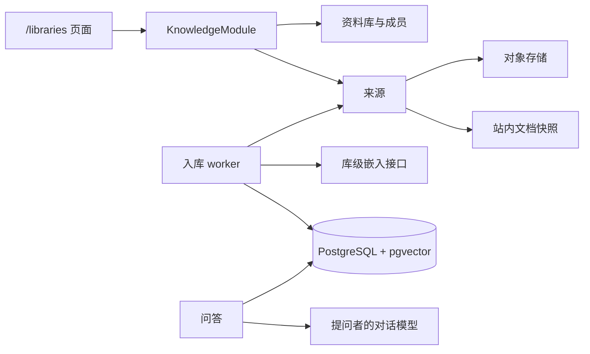

# 资料库（向量检索）系统设计

**日期：** 2026-10-29  
**状态：** 已确认  
**范围：** 独立资料库、成员权限、文件与站内文档快照入库、pgvector 检索、带出处的问答

界面名称用**资料库**。现有「知识库」继续指 `workspace` 文档工作区，本设计不改那套模型和页面。

## 目标

用户可以创建资料库、邀请成员，并放入两类来源：上传的文件，以及本项目里已有文档的一次性快照。系统完成解析、分块、向量化与存储后，成员在资料库页面里按语义检索，并得到带出处的回答。

成功标准：

- 指定资料库内能按语义找到相关片段，结果不串库。
- 问答只依据检索到的片段，并能标出出处。
- 站内文档导入时校验读权限；之后源文档再编辑，索引不自动变化，editor 及以上可手动重索引。
- 同一资料库的向量来自同一套嵌入配置。

## 已确认的决策

| 项 | 决定 |
|----|------|
| 产品形态 | 独立资料库，检索和问答在新页面，与文档工作区并列 |
| 成员 | 资料库自带成员，角色为 `owner` / `admin` / `editor` / `viewer` |
| 嵌入 | 所有者在资料库上配置一套 OpenAI 兼容嵌入接口，全员共用 |
| 对话模型 | 用提问者自己的云端 AI 配置，沿用现有 `UserCloudAiService` |
| 站内文档 | 导入时做快照；不自动同步；可手动重索引 |
| 向量存储 | 现有 PostgreSQL + pgvector，列类型 `vector(1536)` |
| 第一期文件 | `.txt`、`.md`、`.pdf`、`.docx`，单文件不超过 20MB |

## 背景与现状

| 能力 | 现状 | 与本设计的关系 |
|------|------|----------------|
| 知识库 | `workspace` + `workspace_member` | 不复用为向量库。资料库是另一套表 |
| 全文搜索 | 标题与正文关键词 | 保持不变 |
| 编辑器 AI | 续写、改写、单篇问答；正文由客户端传入 | 保持不变。资料库问答不读当前编辑器 |
| 文档正文 | Yjs 持久层 → `Block[]`，`blocksToMarkdown` 可导出 | 导入时走这条路径做快照 |
| 对象存储 | 图片上传使用 COS | 上传的原文件走同一 COS |
| 数据库 | 本地 `postgres:16-alpine`，线上 Neon | 改为带 pgvector 的 Postgres 16；Neon 上启用 `vector` 扩展 |

## 架构



API 放在 `apps/api/src/knowledge/`，职责拆开：

| 单元 | 职责 | 依赖 |
|------|------|------|
| 资料库 | 创建、重命名、删除、成员、嵌入配置 | 现有用户与鉴权 |
| 来源 | 上传、导入快照、重索引、删除 | COS；文档读权限 |
| 入库流水线 | 解析、分块、向量化、提交 | 库级嵌入接口 |
| 检索 | 问题向量化，按库做余弦距离查询 | 分块表 |
| 问答 | 检索后流式生成，并先发出出处 | 检索结果；提问者的对话配置 |

前端：

- `apps/web/app/libraries/page.tsx`
- `apps/web/app/libraries/[libraryId]/page.tsx`
- 组件放在 `apps/web/components/libraries/`
- 侧边栏增加「资料库」入口

桌面端加载同一套 Web，不单独做界面。

数据流是单向的。站内文档只在导入或手动重索引的那次请求里读取。检索和问答只读分块。

## 数据模型

迁移 `012_knowledge_library`。开头执行 `CREATE EXTENSION IF NOT EXISTS vector`。主键 UUID，时间戳 `timestamptz`，角色用 TEXT，与现有表一致。

第一期不建全局 HNSW。查询先按 `library_id` 过滤，再做精确余弦距离排序，避免跨库近似索引漏召回。

### `knowledge_library`

| 列 | 类型 | 说明 |
|----|------|------|
| `id` | UUID PK | |
| `name` | TEXT NOT NULL | 资料库名称 |
| `created_by` | UUID FK → app_user，用户删除时置空 | 创建者，即 owner |
| `embedding_settings` | JSONB NOT NULL DEFAULT `{}` | 嵌入配置，见下文 |
| `embedding_revision` | INT NOT NULL DEFAULT 1 | 模型或 Base URL 变化时加一 |
| `created_at` / `updated_at` | TIMESTAMPTZ | |

嵌入配置 JSON：

| 字段 | 说明 |
|------|------|
| `openAiApiKey` | 只落库。接口只返回 `hasApiKey`，不回传密钥 |
| `openAiBaseUrl` | 默认 `https://api.openai.com/v1` |
| `openAiEmbeddingModel` | 嵌入模型名 |

只改 API Key 时，`embedding_revision` 不变。模型名或 Base URL 变化时加一，并把该库全部来源置为 `queued`。维度固定 1536，不存成可配置项。

### `knowledge_library_member`

主键 `(library_id, user_id)`。索引 `user_id`。删除资料库时级联删除。

| 角色 | 能力 |
|------|------|
| viewer | 看来源状态、检索、问答 |
| editor | 另可上传、导入、重索引、删除来源、下载原文件 |
| admin | 另可邀请、改角色、移除成员。不能改 owner，不能改嵌入配置，不能删除资料库 |
| owner | 另可改嵌入配置、重命名、删除资料库 |

创建者成为唯一 owner。不能把其他成员改成 owner。不能移除唯一 owner（409，文案：资料库至少保留一名所有者）。邀请方式与工作区相同：`userId` 或邮箱。

### `knowledge_source`

| 列 | 类型 | 说明 |
|----|------|------|
| `id` | UUID PK | |
| `library_id` | UUID FK | 级联删除 |
| `kind` | TEXT | `file` 或 `document_snapshot` |
| `title` | TEXT | 文件名或导入时的文档标题 |
| `status` | TEXT | `queued` / `processing` / `ready` / `failed` |
| `error_message` | TEXT NULL | 失败原因 |
| `active_generation` | INT NOT NULL DEFAULT 0 | 问答使用的分块代际。0 表示还没有成功代 |
| `indexed_content_hash` | TEXT NULL | 当前成功代对应正文的 SHA-256 |
| `body_text` | TEXT NULL | 解析或快照得到的正文。成功后保留，供换模型时重新嵌入。列表接口不返回此列 |
| `source_document_id` | UUID NULL | 站内文档 id，不建外键。源文档删除后快照仍在 |
| `storage_key` | TEXT NULL | 文件的 COS key。快照来源为空 |
| `mime_type` | TEXT NULL | |
| `byte_size` | INT NULL | |
| `locked_at` | TIMESTAMPTZ NULL | worker 领取时间 |
| `created_by` | UUID NULL | |
| `created_at` / `updated_at` | TIMESTAMPTZ | |

部分唯一索引：`kind = document_snapshot` 时，`(library_id, source_document_id)` 唯一。同一资料库再次导入同一篇文档，等于重索引。

状态含义：

| status | 含义 |
|--------|------|
| `queued` | 等待处理。`active_generation > 0` 时，问答仍用上一代 |
| `processing` | 已被 worker 领取 |
| `ready` | 当前代已提交 |
| `failed` | `error_message` 有原因。已有上一代时问答继续用上一代 |

界面文案由状态和代际推出，不另设状态值：

| 条件 | 文案 |
|------|------|
| `queued` 或 `processing`，且 `active_generation = 0` | 索引中 |
| `queued` 或 `processing`，且 `active_generation > 0` | 更新中 |
| `ready` | 就绪 |
| `failed`，且 `active_generation = 0` | 索引失败 |
| `failed`，且 `active_generation > 0` | 更新失败，仍可问答 |

### `knowledge_chunk`

| 列 | 类型 | 说明 |
|----|------|------|
| `id` | UUID PK | |
| `library_id` | UUID NOT NULL | 冗余，便于按库过滤 |
| `source_id` | UUID FK → knowledge_source | 级联删除 |
| `generation` | INT NOT NULL | |
| `ordinal` | INT NOT NULL | 来源内顺序，从 0 起 |
| `content` | TEXT NOT NULL | |
| `heading` | TEXT NULL | 标题路径，例如 `概述 / 安装` |
| `page` | INT NULL | PDF 页码，从 1 起 |
| `embedding` | vector(1536) NOT NULL | |
| `embedding_revision` | INT NOT NULL | 写入时的库版本 |
| `created_at` | TIMESTAMPTZ | |

索引：`(library_id)`、`(source_id, generation)`。Prisma 中 `embedding` 使用 `Unsupported("vector(1536)")`，写入和相似度查询走参数化 SQL。

检索只使用同时满足以下条件的分块：`generation = 来源.active_generation`，`active_generation > 0`，且 `embedding_revision = 资料库.embedding_revision`。

## 入库流水线

### 上传文件

editor 及以上。扩展名必须是 `txt`、`md`、`pdf`、`docx` 之一；MIME 只作辅助校验。超过 20MB 直接拒绝，不创建来源。

通过后把原文件写入 COS，key 形如 `knowledge/{libraryId}/{sourceId}/{filename}`，来源状态为 `queued`，`body_text` 为空。

worker 解析规则：

| 类型 | 做法 |
|------|------|
| txt / md | 按 UTF-8 解码。非法字节则失败 |
| docx | 使用 `mammoth` 抽取纯文本 |
| pdf | 使用 `unpdf` 只抽文本层，并保留页码。扫描件没有文本层则失败 |

第一期不做 OCR。解析结果为空，或正文字符数超过 270000，则失败，不调用嵌入接口。270000 字配合 800 字一块、120 字重叠时，不会先撞上 400 块上限。

### 导入站内文档

editor 及以上。请求内调用 `DocumentsService.assertCanRead`。通过后从 Yjs 持久层读取 `Block[]`（现有 `loadDocumentBlocks` 路径），再用 `blocksToMarkdown` 得到快照。需要在文档模块暴露一个「已鉴权后的纯文本导出」，供资料库调用。

正文为空则 400，不创建来源。非空则写入 `body_text`，状态 `queued`。worker 不再打开活文档。

导入完成后，快照属于资料库。其他成员即使打不开源文档，也可以通过检索和问答看到已导入的片段。

源文档后来被删除或导入者失去读权限时，已有分块保留。再次重索引在请求阶段失败，文案说明无法读取源文档。

### 分块

按顺序在这些边界上切：Markdown 标题、空行段落、中英文句末（`。！？；.!?;`），仍超长则按长度硬切。

| 参数 | 值 |
|------|----|
| 目标长度 | 800 字 |
| 重叠 | 120 字 |
| 单来源上限 | 400 块 |

空块丢弃。标题路径写入 `heading`。PDF 按页抽取后再切，页码写入 `page`。超过 400 块则失败，提示拆分文件，且不调用嵌入接口。

### 向量化

`POST {openAiBaseUrl}/embeddings`，Bearer 为资料库的 API Key。请求体包含库上的模型名、每批最多 16 段文本，以及 `dimensions: 1536`。

- 若接口拒绝 `dimensions` 参数，去掉该字段重试一次。
- 返回向量长度不是 1536，则该来源失败。
- HTTP 429 与 5xx 最多重试 3 次，间隔指数退避。
- 401、403 或模型不存在立即失败。
- 密钥不写入日志。

正文做 SHA-256（统一换行符为 `\n`，并去掉首尾空白）得到 `content_hash`。若与 `indexed_content_hash` 相同，且当前成功代的 `embedding_revision` 等于库的当前版本，则跳过嵌入，状态改为 `ready`。模型版本不一致时，用已保存的 `body_text` 重新嵌入，不读取活文档。

### 提交与领取

全部分块都拿到向量后，在一个事务里：

1. 插入 `generation = active_generation + 1` 的分块，`embedding_revision` 取库的当前版本。
2. 把 `active_generation` 更新为这一代，写入 `indexed_content_hash`。
3. 删除该来源更老的分块。
4. 状态改为 `ready`，清空 `error_message` 和 `locked_at`。`body_text` 保留。

嵌入中途失败不写入半套新分块。状态改为 `failed`，`body_text` 保留。

worker 领取后：`body_text` 非空则直接分块；为空则从 COS 下载解析，写入 `body_text` 后再分块。站内文档在排队时必须已有 `body_text`，否则该次任务失败。成功后仍保留 `body_text`，这样更换嵌入模型时可以重新嵌入，而不必再打开活文档。

worker 跑在 API 进程内。`onModuleInit` 每 2 秒领取一次：

```sql
UPDATE knowledge_source
SET status = 'processing', locked_at = now()
WHERE id = (
  SELECT id FROM knowledge_source
  WHERE status = 'queued'
  ORDER BY updated_at
  FOR UPDATE SKIP LOCKED
  LIMIT 1
)
RETURNING *
```

`processing` 且 `locked_at` 早于 10 分钟的行改回 `queued`，保留 `body_text`。不自动重试 `failed`。

### 重索引

| 种类 | 行为 |
|------|------|
| 站内文档 | 请求内再次校验读权限，重取快照覆盖 `body_text`，状态改为 `queued` |
| 文件 | 清空 `body_text`，状态改为 `queued`。worker 看到空正文后从 COS 重新下载并解析 |

`POST /libraries/:id/sources/document` 发现同一库已有该文档的来源时，不新建行，按上表的站内文档重索引更新原行。

已有成功代在新代提交前继续可供问答。

更换模型或 Base URL 时，先由前端确认「将按新模型重建全部来源」。确认后 `embedding_revision` 加一，全部来源改为 `queued`，已有 `body_text` 保留。重建期间检索只用已经写入新版本的分块。

## 检索与问答

任意成员可调用。非成员 403。

检索用资料库嵌入配置把**最新一条用户问题**编成 1536 维向量。查询：

- 过滤 `library_id`、`generation = active_generation`、`active_generation > 0`、`embedding_revision` 等于库的当前版本。
- 余弦距离使用 pgvector 的 `<=>`。相似度 = `1 - 距离`。
- 距离大于 0.8（相似度低于 0.2）的分块丢弃。
- 按距离升序最多取 6 块。
- 按该顺序拼进提示词，总长度不超过 12000 字。单块超出剩余预算时截断后放入。出处摘录最多 500 字。

没有任何块达到阈值时，不调用对话模型。回答固定为：`资料库里没有找到相关内容。`

未参与本次检索的来源数量：该库中不存在「当前代且嵌入版本等于库当前版本」分块的来源个数。

有上下文时，系统提示为：

```text
你是资料库问答助手。只根据给出的编号片段回答问题。
引用依据时使用片段编号，例如 [1]。
片段不足以回答时，直接说明资料库里没有足够依据，不要编造。
```

片段格式：

```text
[1] 来源标题（标题路径或第 N 页）
正文
```

对话历史传给生成模型。检索不用历史，也不做查询改写。代词追问可能检不回前文提到的片段。

流式协议沿用现有 AI SSE。事件顺序：

1. `citations`：`{ citations, pendingSourceCount }`。每条含 `index`（从 1 起）、`sourceId`、`sourceTitle`、`heading`、`page`、`excerpt`、`similarity`。
2. `token`：`{ content }`。
3. `done` 或 `error`：`error` 含 `message`。

无命中时仍先发 `citations`（空列表和 `pendingSourceCount`），再把固定句子作为一个 `token` 发出，然后 `done`。

### 接口

| 方法 | 路径 | 说明 |
|------|------|------|
| GET / POST | `/libraries` | 当前用户的资料库列表 / 创建。创建体为 `{ name }`，去空白后 1 到 80 字 |
| GET / PATCH / DELETE | `/libraries/:id` | 详情 / 重命名 / 删除。删除仅 owner |
| PUT | `/libraries/:id/embedding` | 更新嵌入配置，仅 owner |
| GET / POST | `/libraries/:id/members` | 成员列表 / 邀请 |
| PATCH / DELETE | `/libraries/:id/members/:userId` | 改角色 / 移除 |
| GET | `/libraries/:id/sources` | 来源列表，不含 `body_text` 和密钥 |
| POST | `/libraries/:id/sources/file` | multipart 上传 |
| POST | `/libraries/:id/sources/document` | `{ documentId }` |
| POST | `/libraries/:id/sources/:sourceId/reindex` | 手动重索引 |
| GET | `/libraries/:id/sources/:sourceId/file` | 下载原文件，editor 及以上。快照来源没有原文件，返回 404 |
| DELETE | `/libraries/:id/sources/:sourceId` | 删除来源、分块和 COS 对象。删除资料库时先删光该库文件的 COS 对象，再删库记录 |
| POST | `/libraries/:id/retrieve` | `{ query }`，返回出处与 `pendingSourceCount` |
| POST | `/libraries/:id/qa` | `{ messages }`，SSE |

`messages` 沿用现有 AI 消息形状：`{ role: "user" | "assistant", content }`。最多 20 条，单条最长 8000 字。最后一条必须是非空的 user 消息。`query` 最长 8000 字。

库未配置完整嵌入（缺 Key、Base URL 或模型名）时，检索和问答返回 400：`请先配置资料库的嵌入模型`。提问者没有可用对话配置时，问答返回 400，文案与现有 AI 缺少云端配置时一致。这两项在开始 SSE 之前判断。

## 页面

侧边栏增加「资料库」，进入 `/libraries`。列表对齐工作区列表：名称、角色、来源数、成员数、创建入口。

`/libraries/[libraryId]` 分两块：

- **来源**：上传；按标题搜索当前用户能读的站内文档并导入。每行显示推出的状态文案，失败时显示 `error_message`。存在 `queued` 或 `processing` 时每 3 秒刷新，全部结束后停止。
- **问答**：对话区与出处列表。`[1]` 与出处序号对应。`pendingSourceCount > 0` 时写明有几个来源未参与本次回答。

成员管理、嵌入配置用对话框。嵌入配置只有 owner 能打开，Key 用掩码展示，留空表示不修改已有 Key。

更换模型名或 Base URL 前必须确认会整库重建。删除来源或资料库前必须二次确认。

## 错误表现

| 场景 | HTTP | 用户看到的结果 |
|------|------|----------------|
| 非成员 | 403 | 无权访问该资料库 |
| viewer 上传、导入、删除、下载 | 403 | 查看者无法修改资料库 |
| 非 admin/owner 管理成员 | 403 | 无权管理该资料库成员 |
| 非 owner 改嵌入配置、重命名或删除资料库 | 403 | 无权管理该资料库 |
| 移除唯一 owner | 409 | 资料库至少保留一名所有者 |
| 资料库不存在 | 404 | 资料库不存在 |
| 扩展名不符或超过 20MB | 400 | 拒绝上传，不创建来源 |
| 站内文档为空 | 400 | 文档没有可索引的正文 |
| 无权阅读被导入的文档 | 403 | 无权阅读该文档 |
| 首次索引失败 | 200 创建来源后异步失败 | 行上「索引失败」和 `error_message` |
| 更新失败但已有上一代 | 异步失败 | 「更新失败，仍可问答」 |
| 库未配置嵌入 | 400 | 接口文案：请先配置资料库的嵌入模型。页面上 owner 去配置，其他成员看到请联系所有者 |
| 提问者未配置对话模型 | 400 | 去个人云端 AI 设置 |
| 没有达到相似度的片段 | SSE | 固定句：资料库里没有找到相关内容。 |
| 部分来源未完成当前版本索引 | SSE | 出处区写明未参与数量 |

worker 失败时的 `error_message` 使用中文短句，例如：无法解析 PDF 文本、嵌入服务暂时不可用、嵌入配置无效、正文过长请拆分文件、对象文件不存在。不把供应商原始响应或密钥放进该字段。

## 测试

嵌入接口和对话模型使用假实现，测试不连接真实供应商。

### API（Vitest）

- 分块：标题与段落边界、120 字重叠、丢弃空块、超过 400 块失败。
- 状态：首次失败不产生分块；更新失败保留上一代；哈希与嵌入版本都未变时跳过嵌入；`processing` 超过 10 分钟回到 `queued`。
- 检索：只命中本库、当前代、当前 `embedding_revision`；相似度低于 0.2 不进入上下文；无命中时不调用对话模型，并返回固定句子。
- 权限：viewer 不能上传；非 owner 不能改嵌入配置；非成员不能检索。导入后其他成员能检索到快照片段。
- 模型名变化使 `embedding_revision` 加一；只改 Key 不加。

### 集成

本地 Compose 镜像改为 `pgvector/pgvector:pg16`。有数据库时，用一段短文本走完「写入分块 → SQL 检索命中」。

### Web（Vitest + Testing Library）

- 资料库列表渲染名称与角色。
- 非法扩展名不发起上传。
- 问答区渲染出处，并显示无命中时的固定句子。
- `pendingSourceCount` 显示未参与来源数量。

## 非目标

- OCR、网页抓取、PPT、图片、音视频
- 源文档保存后自动重新索引
- 查询改写、混合关键词检索、跨资料库检索
- 全局 HNSW 或独立向量数据库
- 修改编辑器续写、改写和单篇问答
- Redis、Bull 或其他外部队列
- 资料库公开页、转让 owner、多个 owner
