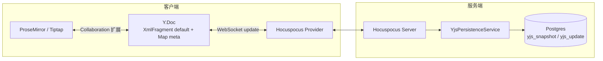

# Yjs 常见问题

**日期：** 2026-08-29  
**状态：** 当前实现  

本文汇总 xtai-notion-open 中与 Yjs 协作相关的常见疑问，重点说明「持久化格式」与「内存文档结构」的区别。更完整的编辑器架构见 [块编辑器架构](./interview/block-editor-architecture.md)。

---

## 1. 本项目的 Yjs 存储是基于 XML 的吗？

**简短回答：数据库里存的不是 XML，但内存中的编辑器内容确实用 `Y.XmlFragment` 表示。**

需要区分两层：

| 层面 | 是否「基于 XML」 | 说明 |
|------|------------------|------|
| **数据库持久化** | 否 | 存的是 Yjs 二进制 CRDT update / snapshot（`Bytes`） |
| **Y.Doc 内容结构** | 是（Tiptap 标准） | 主内容在名为 `default` 的 `Y.XmlFragment` 中 |
| **业务语义** | 块 schema v2 | `blockGroup` → 各块类型，经 TiptapTransformer 与 Xml 树互转 |

这不是项目自定义的 XML 文件存储方案，而是 **Tiptap Collaboration + Hocuspocus** 的常规做法：ProseMirror 文档同步到 Yjs 的 Xml 类型树上，落库时再编码为二进制 update。

---

## 2. 数据库里具体存什么？

表：`yjs_snapshot`、`yjs_update`（见 `apps/api/prisma/schema.prisma`）。

- **`yjs_snapshot.snapshot`**：某一时刻整份 `Y.Doc` 的状态快照（`Y.encodeStateAsUpdate`）
- **`yjs_update.update`**：协作过程中的增量 update（`Uint8Array`）

加载时通过 `Y.applyUpdate` 重放；压缩（compact）时合并 snapshot + 后续 updates，再写回新 snapshot 并删除已合并的 updates。

核心逻辑在 `apps/api/src/collaboration/yjs-persistence.service.ts`：

```typescript
// 加载：snapshot → 再应用 sequence 之后的 updates
Y.applyUpdate(doc, new Uint8Array(snapshot.snapshot))
Y.applyUpdate(doc, new Uint8Array(row.update))

// 压缩：整份文档编码为 snapshot
const snapshot = Y.encodeStateAsUpdate(doc)
```

**不会**把文档存成 XML 字符串或 JSON 块树；对外只读渲染时，才在运行时通过 `documentFromYjs()` 从 Y.Doc 转成 `Block[]`。

---

## 3. Y.Doc 里有哪些共享类型？

当前实现主要使用两类 Yjs 共享结构：

### 3.1 `default` — `Y.XmlFragment`（编辑器正文）

- 协作字段名常量：`COLLABORATION_FIELD = "default"`（`packages/editor-react/src/react/providers/collaboration-editor-provider.tsx`）
- Tiptap `@tiptap/extension-collaboration` 将 PM 文档绑定到此 fragment
- 树形结构：`Y.XmlFragment` → `Y.XmlElement`（块节点）→ `Y.XmlText`（行内文本）

初始化与转换见 `packages/editor-core/src/core/yjs-document.ts`：

```typescript
// 块 schema v2：default XmlFragment + schemaVersion=2
const yDoc = TiptapTransformer.extensions(extensions).toYdoc(json, "default")
```

判断是否为空文档时，也是检查该 fragment 是否无子节点：

```typescript
document.getXmlFragment("default").length === 0
```

### 3.2 `meta` — `Y.Map`（元数据）

- 键 `schemaVersion`：块 schema 版本，与 DB `documents.schema_version` 对齐
- 读写：`packages/editor-core/src/core/migrate/migrate-ydoc.ts` 中的 `readYDocSchemaVersion` / `writeYDocSchemaVersion`
- 当前版本：`CURRENT_SCHEMA_VERSION = 2`

---

## 4. 和 `Block[]` 的关系是什么？

对外 API 与 UI 以 `Block[]` 为文档单位；协作层**只持久化 Yjs**，不把 `Block[]` JSON 另存一份到 Postgres。

转换路径：

```
Y.Doc (XmlFragment "default")
  ↔ TiptapTransformer.fromYdoc / toYdoc
  ↔ ProseMirror JSON
  ↔ blocksToPmDoc / pmDocToBlocks
  ↔ Block[]
```

入口函数：

- `documentFromYjs(yDoc)`：Y.Doc → `Block[]`（只读、公开 API、摘要等）
- `createBlockSchemaYDoc(blocks?)`：新建协作文档
- `appendTextToBlockSchemaYDoc(yDoc, text)`：向已有文档追加文本（优先原地改 `Y.XmlText`，协作更安全）

若 `fromYdoc` 结果根下第一层不是 `blockGroup`，会抛出「不支持的 Yjs 文档形状」错误，即只支持块 schema v2。

---

## 5. 协作数据流（简图）



---

## 6. 相关代码与文档索引

| 主题 | 位置 |
|------|------|
| 持久化服务 | `apps/api/src/collaboration/yjs-persistence.service.ts` |
| 持久化仓储 | `apps/api/src/collaboration/yjs-persistence.repository.ts` |
| Y.Doc ↔ Block[] | `packages/editor-core/src/core/yjs-document.ts` |
| Schema 版本 | `packages/editor-core/src/core/migrate/migrate-ydoc.ts` |
| 协作 Provider | `packages/editor-react/src/react/providers/collaboration-editor-provider.tsx` |
| Collaboration 扩展配置 | `packages/editor-core/src/core/extensions/build-block-schema-extensions.ts` |
| 块编辑器总览 | [块编辑器架构](./interview/block-editor-architecture.md) |
| Update 序号并发 | [Yjs Sequence Allocation](./superpowers/specs/2026-08-11-yjs-sequence-allocation-design.md) |

---

## 7. 其他常见问题

### 7.1 为什么不直接把 `Block[]` 存数据库？

协作需要 CRDT 合并与增量同步；Yjs update 字节流是 Hocuspocus 生态的标准持久化单元。`Block[]` 作为对外稳定契约，在读取时从 Y.Doc 派生即可。

### 7.2 空文档如何判断？

协作侧：远程 `default` XmlFragment 长度为 0（`isRemoteDocumentEmpty`）。  
业务侧：也可用 `blockSchemaYDocHasContent(yDoc)` 检查是否已有实质块内容。

### 7.3 压缩（compact）何时触发？

`YjsPersistenceService` 在待持久化的 update 条数达到阈值（默认 50）时，将 snapshot + updates 合并为新 snapshot，并删除已合并的 updates，以控制表体积与加载成本。
