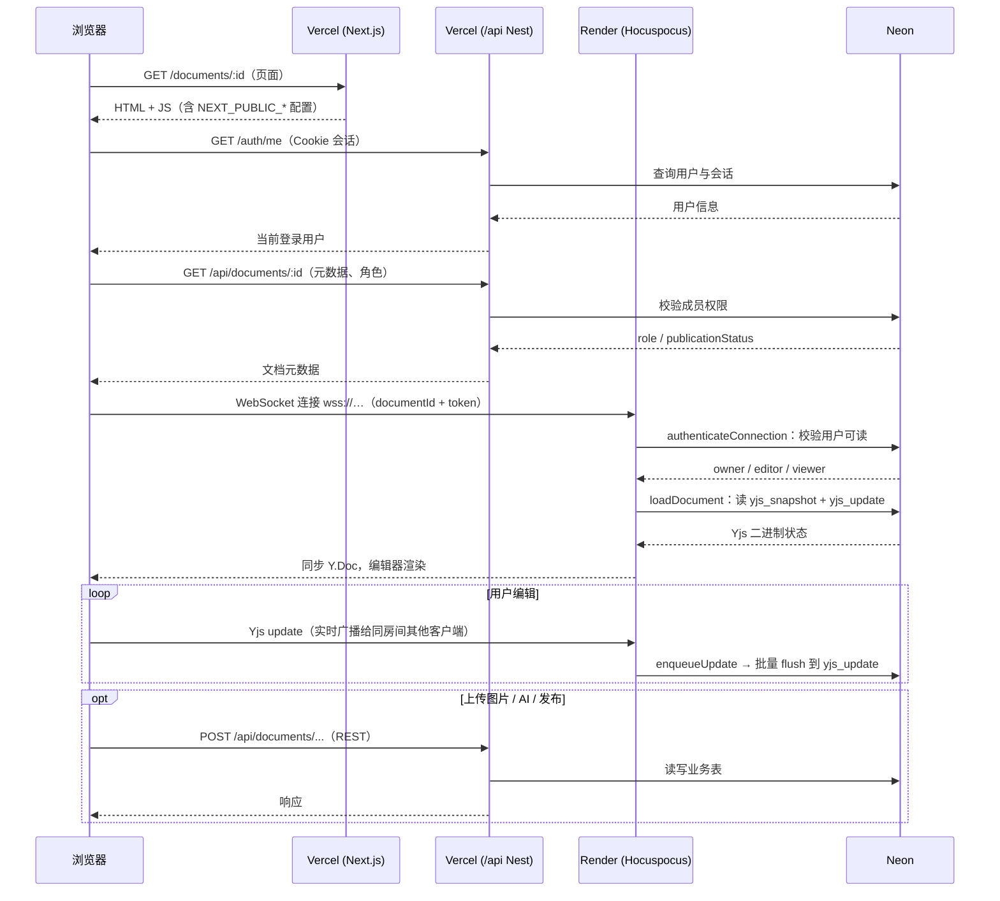

# 部署架构与时序

**日期：** 2026-08-31  
**状态：** 当前生产推荐方案  

本文说明 xtai-notion-open 在 **Vercel + Render + Neon** 三分部署下的职责划分，以及用户打开文档后的完整请求链路。具体操作步骤见：

- Web + REST API：[deploy-vercel.md](./deploy-vercel.md)
- 协作 WebSocket：[deploy-render.md](./deploy-render.md)

---

## 1. 为什么要拆成三个平台？

本项目同时有两种完全不同的流量形态：

| 流量类型 | 特点 | 适合的平台 |
|----------|------|------------|
| **HTTP 短请求** | 登录、拉文档元数据、上传图片、AI 接口等；请求结束即可释放资源 | Vercel（Next.js + Serverless） |
| **WebSocket 长连接** | 多人实时协作；连接需长期保持，服务端要在内存中维护房间状态 | Render（常驻 Node 进程） |
| **关系型数据** | 用户、文档、权限、Yjs 快照与增量 | Neon（托管 Postgres） |

**Vercel 擅长托管前端和按请求计费的 API**，但不适合作为 Hocuspocus 这类协作服务器的主战场：协作编辑依赖 WebSocket 长连接与进程内状态，而 Vercel Serverless Function 更适合「来一个 HTTP 请求、处理完就结束」的短生命周期任务。

因此 README 中的推荐组合是：

| 组件 | 平台 | 入口 |
|------|------|------|
| Web + REST API | [Vercel](https://vercel.com) | `apps/web` + `apps/web/api/nest.ts` |
| 协作 WebSocket | [Render](https://render.com) | `apps/api/src/collab-main.ts` |
| 数据库 | [Neon](https://neon.tech) | 两边共用 `DATABASE_URL` |

---

## 2. 整体架构

```text
                         ┌─────────────────────────────────────┐
                         │           用户浏览器                 │
                         └──────────────┬──────────────────────┘
                                        │
              HTTPS（页面、REST）        │        WSS（实时协作）
                        ┌───────────────┴───────────────┐
                        ▼                               ▼
              ┌──────────────────┐           ┌──────────────────┐
              │     Vercel       │           │     Render       │
              │                  │           │                  │
              │  Next.js 页面    │           │  collab-main.ts  │
              │  /api/* Nest API │           │  Hocuspocus WS   │
              └────────┬─────────┘           └────────┬─────────┘
                       │                              │
                       │         DATABASE_URL         │
                       └──────────────┬───────────────┘
                                      ▼
                            ┌──────────────────┐
                            │      Neon        │
                            │   PostgreSQL     │
                            │ yjs_snapshot /   │
                            │ yjs_update / …   │
                            └──────────────────┘
```

### 各平台在本项目中的职责

**Vercel**

- 托管 Next.js 站点（`/documents`、`/square`、登录注册等）
- 通过 Serverless 运行 Nest REST API（`/api/auth/*`、`/api/documents/*` 等）
- 处理 Cookie 会话、文档 CRUD、图片上传、AI 接口等**无状态或短连接**业务

**Render**

- 运行 **仅协作** 的 Node 进程（`pnpm --filter api start:collab` → `collab-main.ts`）
- 对外提供 `wss://<服务名>.onrender.com`
- 在内存中维护 Hocuspocus 房间，把 Yjs 增量异步写入 Neon

**Neon**

- 存储用户、文档、成员权限、发布状态等业务表
- 存储 Yjs 持久化数据（`yjs_snapshot`、`yjs_update`）
- Vercel 上的 API 与 Render 上的协作服务**共用同一库**

---

## 3. 环境变量如何串联

| 变量 | 设置位置 | 作用 |
|------|----------|------|
| `DATABASE_URL` | Vercel + Render | 连接 Neon（生产请用带 `-pooler` 的池化连接串） |
| `NEXT_PUBLIC_API_URL` | Vercel（可选） | 默认同域 `/api`，一般不必设置 |
| `NEXT_PUBLIC_COLLABORATION_URL` | Vercel | 前端连接协作服务，形如 `wss://xxx.onrender.com` |

前端在文档布局中注入协作地址（见 `apps/web/app/documents/[documentId]/layout.tsx`），编辑器通过 `websocketUrl` 连接 Render。

---

## 4. 时序：用户打开一篇文档

以下以已登录用户访问 `/documents/:documentId` 为例。



### 分步说明

**① 加载页面（Vercel / Next.js）**

- 浏览器请求文档路由，Next.js 返回应用壳层与静态资源。
- `AuthProvider` 调用 `/auth/me` 确认登录态（同域 Cookie，经 `vercel.json` 转发到 Nest）。

**② 拉取文档元数据（Vercel / REST API）**

- `DocumentWorkspace` 请求 `GET /api/documents/:id`，获取标题、角色（owner/editor/viewer）、发布状态等。
- 这一步走 **HTTP 短请求**，不经过 Render。

**③ 建立协作连接（Render / WebSocket）**

- 编辑器使用 `NEXT_PUBLIC_COLLABORATION_URL` 连接 Hocuspocus，房间名为 `documentId`。
- 连接时携带 `token: user.id`（见 `document-workspace.tsx`）；服务端在 `CollaborationAuthService` 中校验该用户是否有读权限。
- 鉴权通过后，Hocuspocus 从 Neon 加载 Yjs 状态（`onLoadDocument` → `YjsPersistenceService.loadDocument`）。

**④ 实时编辑与持久化（Render → Neon）**

- 每次文档变更，Hocuspocus 触发 `onChange`，将 update 放入内存缓冲。
- 定时或阈值触发 `flush`，写入 Neon 的 `yjs_update` 表；必要时压缩为 `yjs_snapshot`。
- 同一文档的其他在线用户通过 WebSocket 收到增量，实现多人同步。

**⑤ 仍走 Vercel API 的操作**

以下能力**不经过**协作 WebSocket，而是继续请求 Vercel 上的 REST API：

- 图片上传到 COS（`POST /api/documents/:id/images`）
- AI 写作 / 助手
- 发布审批、后台管理、评论等

---

## 5. Render 与 Vercel 对比（结合本项目）

| 维度 | Vercel | Render（协作服务） |
|------|--------|-------------------|
| 主要用途 | 网站 + REST API | Hocuspocus 长连接 |
| 进程模型 | Serverless，按请求唤起 | 常驻 Web Service |
| 协议 | HTTPS | WSS（WebSocket） |
| 本项目入口 | `apps/web`、`apps/web/api/nest.ts` | `apps/api/src/collab-main.ts` |
| 本地开发端口 | Web `3000`，API `3100` | 协作 `3101` |
| 免费层注意点 | 函数时长与调用次数限制 | 15 分钟无流量会休眠，冷启动约 1 分钟 |

本地开发时，`pnpm --filter api dev` 会同时启动 REST（3100）与协作（3101）；生产环境则拆到 Vercel 与 Render 两个域名。

---

## 6. 协作进程与 API 进程的区别

| | 本地 `main.ts` | 生产 `collab-main.ts`（Render） |
|--|----------------|----------------------------------|
| Nest REST | 监听 `PORT`（3100） | **不启动** |
| Hocuspocus | 监听 `COLLABORATION_PORT`（3101） | 监听 Render 注入的 `PORT` |
| 适用场景 | `pnpm dev` | Render / 单端口 PaaS |

Render 只暴露一个对外端口，因此协作入口专门做了「单端口模式」：只初始化 `CollabAppModule` 与 Hocuspocus，不绑定 REST HTTP。

---

## 7. 常见问题

### 页面能打开，但协作一直「连接中」

1. 检查 Vercel 是否配置 `NEXT_PUBLIC_COLLABORATION_URL`（必须是 `wss://`）。
2. 打开 Render 服务日志，确认 `collab-main` 已启动且未休眠。
3. 确认用户对文档有成员权限（否则 WebSocket 鉴权会失败）。

### API 正常，协作报 unauthorized

- 协作鉴权与 API 是否同域无关；需保证 `token` 或会话 Cookie 能被 `CollaborationAuthService` 解析。
- `DATABASE_URL` 必须与 API 使用**同一 Neon 数据库**，否则权限与 Yjs 数据会对不上。

### 能否把协作也部署到 Vercel？

不推荐。Vercel 对 WebSocket 长连接与常驻房间状态的支持不适合作为 Hocuspocus 主服务。若必须单平台部署，需改用支持 WebSocket 的 VPS / Fly.io / Railway 等，架构思路与 Render 相同。

---

## 8. 相关代码与文档

| 主题 | 位置 |
|------|------|
| 协作鉴权 | `apps/api/src/collaboration/collaboration-auth.service.ts` |
| Yjs 落库 | `apps/api/src/collaboration/yjs-persistence.service.ts` |
| Hocuspocus 钩子 | `apps/api/src/collaboration/hocuspocus-hooks.ts` |
| 前端连接协作 | `apps/web/components/inkspace/document-workspace.tsx` |
| Yjs 存储格式 FAQ | [yjs-常见问题.md](./yjs-常见问题.md) |
| Vercel 部署 | [deploy-vercel.md](./deploy-vercel.md) |
| Render 部署 | [deploy-render.md](./deploy-render.md) |
